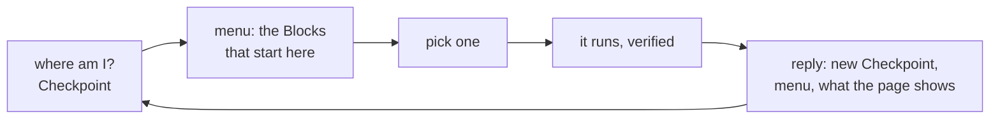

# Agents and exploring

Your Blocks are also a menu. `waygraph auto` lets a person pick the next Block by hand; a **session** lets a coding
agent do the same, one JSON call at a time, using only Blocks you have already checked.



## By hand: `auto`

| Want | Command |
|---|---|
| a menu in the terminal | `npx waygraph auto --cli` |
| the same menu as a panel in the browser | `npx waygraph auto` |
| find a route from one Checkpoint to another, then play it | `npx waygraph auto --blocks LoginPage OrderComplete` |
| try it on Sauce Demo, nothing written to your folder | `npx waygraph try auto` · `npx waygraph try auto:cli` |

The menu has **Methods** for this page, **Also on this page** (one row per item an Effect can act on, plus Add all /
Remove all), **Navigate** and **Go back**. Keys a Block needs come from `--data`, else the project's mem stubs.

## For an agent: a session

A session is a browser that keeps running in the background. Every command takes its id and answers with JSON.

```sh
npx waygraph pilot start [--data '{...}']      # browser + the whole graph + where it is; --data: whose keys (else mem stubs)
npx waygraph pilot status  <id>                # the menu, no side effects
npx waygraph pilot send    <id> submit-login   # run one Block (a menu index or a name); --data '{...}' sets keys first
npx waygraph pilot reach   <id> OrderComplete  # find the route and play it, checking every step
npx waygraph pilot read    <id> catalog.items  # what the page shows (Read Blocks)
npx waygraph browser stop  <id>                # done
```

| Command | Answers |
|---|---|
| `status`, `send`, `reach` | the Checkpoint, the menu, `read` for the page it landed on, and `mem`: where each key's value came from (`data`, `stub`, `step`) |
| `read [path] [--where f=v] [--rows a:b]` | what the page shows, all of it or one part ([Read Blocks](./reads)) |
| `dom [--mode full] [--selector s]` | the accessibility tree (small), or the DOM (bounded) |
| `trace` | the Blocks this session ran and where each landed |
| `console` | console and network errors, and links or buttons no Block covers yet |
| `watch` | every step, read and snapshot as JSON lines, live |
| `resync` | where am I, checked again against the real page (after a person clicked around) |

## No Blocks yet: blind pilot

An agent can start on an app with no Blocks: act on the raw page, then write the Block it just used and pick it up
without restarting.

```sh
npx waygraph browser start --goto /login
npx waygraph auto goto  <id> /login
npx waygraph auto type  <id> "#username" "standard_user"
npx waygraph auto click <id> "#login-button"
npx waygraph auto reload <id>                  # loads the Block files just written
```

## Session commands at a glance

| Prefix | Is |
|---|---|
| `waygraph auto` | the interactive picker (and the raw `click` / `type` / `goto`) |
| `waygraph browser` | sessions: `start`, `sessions`, `stop`, `attach` |
| `waygraph pilot` | `start` = `browser start` + the graph; then the same commands |

All three reach the same session by the same id. `browser sessions` lists the live ones; close every session you
start.

## Skills for coding agents

`waygraph init` puts three skills in `.agents/skills/`: **waygraph-convention** (where files go, how Blocks are
written), **waygraph-pilot** (driving a session) and **waygraph-blind-pilot** (starting from nothing).

```sh
npx waygraph agent-dive --loop claude      # also opencode, cursor, vscode: planner / author / healer agents
npx waygraph --skill-convention            # print a skill
npx waygraph upgrade --skills              # refresh them after updating waygraph
```

Every command and the session protocol (for a client of your own): [Pilot](../reference/pilot),
[CLI](../reference/cli).
