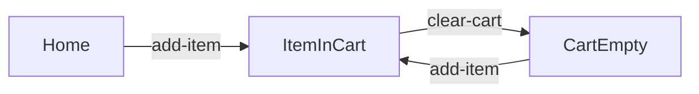

# Blocks

A Block is one step: it starts on a Checkpoint, does one thing, and lands on a Checkpoint.



## Checkpoints first

A Checkpoint is a place the app can be. Each one is declared once, in `src/states/`, as a value and a type with the
same name:

```ts
// src/states/demo.states.ts
import { checkpoint } from "waygraph";

export const Home = checkpoint("Home");
export type Home = typeof Home;
export const ItemInCart = checkpoint("ItemInCart");
export type ItemInCart = typeof ItemInCart;
export const CartEmpty = checkpoint("CartEmpty");
export type CartEmpty = typeof CartEmpty;

export const CanAddItem = [Home, CartEmpty] as const;   // "any of these"
export type CanAddItem = (typeof CanAddItem)[number];
```

Two Checkpoints can share a URL: `Home` and `ItemInCart` are the same page in two states.

## The kinds

| Kind | Use it to | Made with | Moves? |
|---|---|---|---|
| Nav | open a page by URL or by a link | `defineNavBlock` (`url`) · `defineNavClickBlock` (`click`) | to its `checkpoint` |
| Page | say "you are here" and list what you can do | `definePageBlock` | no |
| Method | do one thing: fill, click, submit | `defineMethodBlock` | `from` → `to` |
| Effect | do one thing to one row of many | `defineEffectBlock` | `from` → `to` |
| Assert | check something, change nothing | `defineAssertBlock` | no |
| API | make an HTTP call, no page | `defineApiBlock` | `from` → `to` |
| Read | say what the page shows | `defineReadBlock` | never ([Read Blocks](./reads)) |

All of them are plain Blocks when the flow runs; the kind is what `map()` and `waygraph check` hold you to.

## Nav: getting to a page

```ts
export const NavHomeBlock = defineNavBlock({
  name: "nav-home",
  description: "Opens the catalog page.",
  checkpoint: Home,
  url: "/home",                                    // or (mem) => `/orders/${mem.get(OrderKeys.id)}`
  verify: [Trait.text(DemoSel.title, "Hello Waygraph")],
});
```

Only Nav Blocks navigate. In any other Block, `page.goto` / `reload` / `goBack` show as deprecated in the editor, and
`waygraph check` warns about them.

A Nav can be opened from anywhere by default. A page you can only reach after signing in says so with `from`, so route
finding (`auto`, `pilot reach`, `traverse`) signs in first:

```ts
export const SIGNED_IN = [Dashboard, Settings] as const;
defineNavBlock({ name: "nav-equipment", checkpoint: Equipment, url: "/equipment", from: SIGNED_IN });
```

## Method: one action

```ts
export const ClearCartBlock = defineMethodBlock({
  name: "clear-cart",
  description: "Clears every item via the Clear cart control.",
  from: ItemInCart,
  to: CartEmpty,
  instruction: {
    async act(page) {
      await page.locator(DemoSel.clear).click();
    },
    verify: [Trait.text(DemoSel.cartCount, "0")],
  },
});
```

**One action per Block.** A login form is `fill-username`, `fill-password` and `submit-login`: three Blocks, never
one. `waygraph check` warns on a Method that fills more than once or fills and clicks.

When a Block can land in more than one place, `to` is a list and `resolve` picks the one it reached:

```ts
defineMethodBlock({
  name: "submit-login",
  from: LoginPage,
  to: [LoggedIn, LoginPage],                        // a wrong password stays here
  instruction: {
    async act(page) { await page.locator(LoginSel.submit).click(); },
    async observe(page) { return page.url().includes("/inventory") ? "in" : "out"; },
    resolve: (seen) => (seen === "in" ? LoggedIn : LoginPage),
  },
});
```

| Phase | Does | May touch |
|---|---|---|
| `act` | the action | the page, mem |
| `observe` | looks at what happened (only when `to` is a list) | the page, mem |
| `resolve` | names the Checkpoint | nothing: it gets only what `observe` returned |
| `verify` | checks the page is what `resolve` said ([Checks](./checks)) | reads only |

## Page: the hub

```ts
export const HomePageBlock = definePageBlock({
  name: "page-home",
  checkpoint: Home,
  verify: [Trait.visible(DemoSel.catalog)],
  methods: {
    addItem: () => AddItemBlock,
    clearCart: () => ClearCartBlock,
  },
});
```

`waygraph auto` groups a page's methods under it, and they never count as orphans.

## Effect: one row of many

An Effect is a Method that also lists the rows it can act on, so `waygraph auto` shows "Add Alpha", "Add Beta"…:

```ts
defineEffectBlock({
  name: "add-item",
  from: CanAddItem,
  to: ItemInCart,
  requires: [DemoKeys.selectedItem],
  instruction: {
    async act(page, _input, mem) {
      await page.locator(DemoSel.addBtn(mem.get(DemoKeys.selectedItem).id)).click();
    },
  },
  async instanceOptions(page) {
    // one { id, label, key: DemoKeys.selectedItem, value, highlight } per Add button on the page
  },
});
```

## Assert and API

```ts
export const AssertSubmitGatedBlock = defineAssertBlock({
  name: "assert-submit-gated",
  checkpoint: CheckoutInfoPage,
  verify: [Trait.disabled(CheckoutSel.submit)],
});

export const CheckOrderCreatedBlock = defineApiBlock({
  name: "check-order-created",
  from: LoggedIn,
  to: [OrderConfirmed, OrderFailed],
  method: "GET",                                          // shown in the demo's network tab
  call: ({ request }) => request.get("/api/orders/latest"), // shares the browser's cookies
  resolve: (r) => (r.ok ? OrderConfirmed : OrderFailed),  // r = { status, ok, body }
});
```

## Selectors live in `_sel.ts`

```ts
export const DemoSel = {
  title: "h1",
  cartCount: "[data-test=cart-count]",
  addBtn: (id: string) => `[data-test=add-${id}]`,
} as const;
```

A selector written inline in a Block, or a regex / XPath selector, is a `waygraph check` warning. Mem holds values
(which item); `_sel.ts` holds where things are on the page.

## Several Blocks as one

| Helper | Gives |
|---|---|
| `composeBlock(name, steps)` | one named Block made of several, each keeping its own `verify` |
| `fastForwardComposeBlock(name, steps)` | the same, played at full speed in the demo (sign-in you don't need to watch) |
| `withVerify(block, verify)` | the same Block with other checks |
| `withDialog(block, { accept, into })` | answers the `confirm()` / `alert()` the Block's action opens |

## Lint it

```sh
npx waygraph check        # navigation outside Nav Blocks, inline selectors, empty verify, orphans, pages no Read Block reads
npx waygraph typecheck    # tsc --noEmit, then the same checks
```

Silence one warning on purpose with `// waygraph-ignore: empty-verify` (or `multi-input`, `combined-action`,
`hand-written-ui`) in that file.
