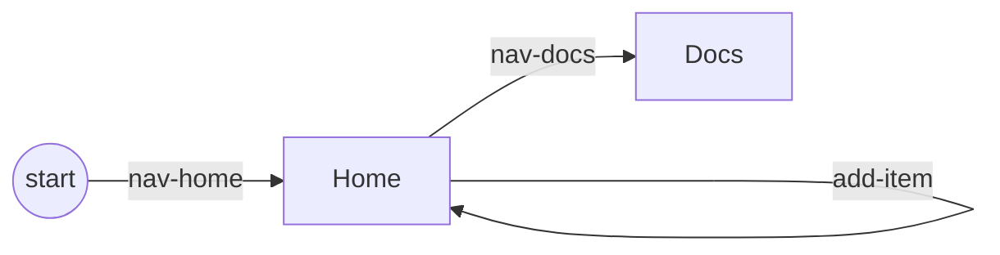

# Blocks

A Block is one step: it starts on a Checkpoint, does one thing, and lands on a Checkpoint.



## Checkpoints first

A Checkpoint is a page: a place the app can be, with its own address. Each one is declared once, in `src/states/`,
as a value and a type with the same name:

```ts
// src/states/demo.states.ts
import { checkpoint } from "waygraph";

export const Home = checkpoint("Home");
export type Home = typeof Home;
export const Docs = checkpoint("Docs");
export type Docs = typeof Docs;

export const HomeOrDocs = [Home, Docs] as const;   // "any of these"
export type HomeOrDocs = (typeof HomeOrDocs)[number];
```

What changes on a page is not another Checkpoint. Adding an item to the cart leaves you on `Home`; what changed is
what Home shows, its [Read Block](./reads)'s `home.cartCount` and each item's `inCart`, which the Block's `verify`
checks. A link sent, an alert shown, a banner up: the same. `waygraph check` names a Checkpoint that is a state of a
page (only Methods land on it and it has no address of its own, or it has another page's).

One Checkpoint comes with waygraph: `Start`, where every flow begins, before its first step. A Block that leads off a
flow starts `from: Start`; one that sends the run back to the beginning (signing out) goes `to: Start`.

```ts
import { Start } from "waygraph";

defineMethodBlock({ name: "sign-out", from: Dashboard, to: Start, instruction: { … } });
```

## The kinds

| Kind | Use it to | Made with | Moves? |
|---|---|---|---|
| Nav | open a page by URL or by a link | `defineNavBlock` (`url`) · `defineNavClickBlock` (`click`) | to its `checkpoint` |
| Page | say "you are here" and list what you can do | `definePageBlock` | no |
| Method | do one thing: fill, click, submit (or to one row of many: [rows](#a-method-on-one-row-of-many)) | `defineMethodBlock` | `from` → `to` |
| Expect | what a scenario expects on a page: reads and judges, changes nothing | `defineExpectBlock` | no (an expectation, not a step) |
| API | make an HTTP call, no page | `defineApiBlock` | `from` → `to` |
| Read | say what the page shows | `defineReadBlock` | never ([Read Blocks](./reads)) |

All of them are plain Blocks when the flow runs; the kind is what `map()` and `waygraph check` hold you to.

## Nav: getting to a page

```ts
export const NavHomeBlock = defineNavBlock({
  name: "nav-home",
  description: "Opens the catalog page.",
  checkpoint: Home,
  url: "/home",                                    // or (mem) => `/orders/${mem.get(OrderKeys.id)}`
  verify: [Trait.text(DemoSel.title, "Hello Waygraph")],
});
```

Only Nav Blocks navigate. In any other Block, `page.goto` / `reload` / `goBack` show as deprecated in the editor, and
`waygraph check` warns about them.

A Nav can be opened from anywhere by default. A page you can only reach after signing in says so with `from`, so route
finding (`auto`, `pilot reach`, `traverse`) signs in first:

```ts
export const SIGNED_IN = [Dashboard, Settings] as const;
defineNavBlock({ name: "nav-equipment", checkpoint: Equipment, url: "/equipment", from: SIGNED_IN });
```

## Method: one action

```ts
export const ClearCartBlock = defineMethodBlock({
  name: "clear-cart",
  description: "Clears every item via the Clear cart control.",
  from: Home,
  to: Home,
  instruction: {
    async act(page) {
      await page.locator(DemoSel.clear).click();
    },
    verify: [HomeRead.cartCount.is(0)],   // what the page shows now: no item in the cart
  },
});
```

**One action per Block.** A login form is `fill-username`, `fill-password` and `submit-login`: three Blocks, never
one. `waygraph check` warns on a Method that fills more than once or fills and clicks.

When a Block can land in more than one place, `to` is a list and `resolve` picks the one it reached:

```ts
defineMethodBlock({
  name: "submit-login",
  from: LoginPage,
  to: [InventoryPage, LoginPage],                        // a wrong password stays here
  instruction: {
    async act(page) { await page.locator(LoginSel.submit).click(); },
    async observe(page) { return page.url().includes("/inventory") ? "in" : "out"; },
    resolve: (seen) => (seen === "in" ? InventoryPage : LoginPage),
  },
});
```

| Phase | Does | May touch |
|---|---|---|
| `act` | the action | the page, mem |
| `observe` | looks at what happened (only when `to` is a list) | the page, mem |
| `resolve` | names the Checkpoint | nothing: it gets only what `observe` returned |
| `verify` | checks the page is what `resolve` said ([Checks](./checks)) | reads only |

## Page: the hub {#page-blocks}

```ts
export const HomePage = definePageBlock({
  name: "page-home",
  checkpoint: Home,
  nav: NavHomeBlock,                                 // its _nav.block.ts
  verify: [Trait.visible(DemoSel.catalog)],
  methods: {
    addItem: () => AddItemBlock,
    clearCart: () => ClearCartBlock,
  },
});
```

A Page Block is the page's namespace: `HomePage.nav` opens it, `HomePage.do.addItem` is the Add Item Block, typed as
itself, and `HomePage.expects.hello` an Expect Block for the page (`expects: { hello: () => ExpectHelloBlock }`).
A flow imports the page, not each Block:

```ts
engine.map().gotoPage(HomePage.nav).method(HomePage.do.addItem, { expect: [HomeRead.cartCount.is(1)] });
```

`waygraph auto` groups a page's methods under it. A page's `nav`, methods and expectations never count as orphans,
though no flow plays them; nor does a Block a flow names in an `expect: [...]` (a step's, or a Block's own). Name the Page Block after the page
(`HomePage`): the Checkpoint already has the page's own name (`Home`).

## Screenshots

`screenshot: true` (or `{ fullPage: true }`) on a Block takes a screenshot of the page as the last thing in its step:
after its action, its checks, its expectations and the page's read. On a Page Block it's the page's: every step that lands
on that page takes one, whichever Block it was.

```ts
export const CartPage = definePageBlock({ name: "page-cart", checkpoint: CartPage, screenshot: true, ... });
```

Each is kept with its run (`.waygraph/runs/<runId>/<step>-<block>.png`, a `run:artifact` in the [run log](../reference/run-log)
naming the step and the page), and the newest per page as `.waygraph/screenshots/<Checkpoint>.png`.
[Waygraph Studio](./studio) shows a page's newest on its map, and each step's on the run. waygraph's own overlay (the demo's
panel, rings, banner) is left out of the picture; a screenshot that can't be taken never fails the step.

## A Method on one row of many

A Method that acts on one row of several (add *this* item) names the row in mem (`requires`) and lists the rows on the
page (`instanceOptions`), so `waygraph auto` shows "Add Alpha", "Add Beta"…:

```ts
defineMethodBlock({
  name: "add-item",
  from: Home,
  to: Home,
  requires: [DemoKeys.selectedItem],
  instruction: {
    async act(page, _input, mem) {
      await page.locator(DemoSel.addBtn(mem.get(DemoKeys.selectedItem).id)).click();
    },
    verify: [
      HomeRead.items.passes((items, mem) => items.some((i) => i.name === mem.get(DemoKeys.selectedItem).name && i.inCart), "the item in the cart"),
    ],
  },
  async instanceOptions(page) {
    // one { id, label, key: DemoKeys.selectedItem, value, highlight } per Add button on the page
  },
});
```

## Expect and API

```ts
export const ExpectSubmitGatedBlock = defineExpectBlock({
  name: "expect-submit-gated",
  description: "Continue stays disabled until the form is filled.",
  checkpoint: CheckoutInfoPage,
  verify: [Trait.disabled(CheckoutSel.submit)],
});

export const CheckOrderCreatedBlock = defineApiBlock({
  name: "check-order-created",
  from: InventoryPage,
  to: [OrderConfirmed, OrderFailed],
  method: "GET",                                          // shown in the demo's network tab
  call: ({ request }) => request.get("/api/orders/latest"), // shares the browser's cookies
  resolve: (r) => (r.ok ? OrderConfirmed : OrderFailed),  // r = { status, ok, body }
});
```

An Expect Block goes in an `expect: [...]` list, on a Block or on a step, never as a step of its own; it only reads
([Checks](./checks#expect-what-the-scenario-expects)).

## Selectors live in `_sel.ts`

```ts
export const DemoSel = {
  title: "h1",
  cartCount: "[data-test=cart-count]",
  addBtn: (id: string) => `[data-test=add-${id}]`,
} as const;
```

A selector written inline in a Block, or a regex / XPath selector, is a `waygraph check` warning. Mem holds values
(which item); `_sel.ts` holds where things are on the page.

## Several Blocks as one

| Helper | Gives |
|---|---|
| `composeBlock(name, steps)` | one named Block made of several, each keeping its own `verify` |
| `fastForwardComposeBlock(name, steps)` | the same, played at full speed in the demo (sign-in you don't need to watch) |
| `withVerify(block, verify)` | the same Block with other checks |
| `withDialog(block, { accept, into })` | answers the `confirm()` / `alert()` the Block's action opens |

## Lint it

```sh
npx waygraph check        # navigation outside Nav Blocks, inline selectors, empty verify, orphans, pages no Read Block reads,
                          # Checkpoints that are a state of a page (no address of their own, or another page's)
npx waygraph typecheck    # tsc --noEmit, then the same checks
```

`check` also points out code written for something waygraph already does, in any file (helpers and specs too):

| Warning | Found | Use instead |
|---|---|---|
| `cast-to-outcome` | `Block as MethodBlock<A, B>` | `.method(Block, { lands: B })` (`upgrade --codemod lands`) |
| `ff-run` | `{ ff: true }` on three or more steps in a row | `.ffStart()` … `.ffEnd()` (`upgrade --codemod ff`) |
| `hand-rolled-retry` | a polling loop in a Trait file | nothing: Traits retry, and say what they wanted and saw |
| `seeded-spec` | `seedMemStub` in a spec | `memStub: true`: the flow fills keys when it runs |
| `builder-helper` | a function over `MapBuilder` | a part, `steps(Checkpoint, (m) => …)`, or an account for signing in |
| `overlay-workaround` | a dispatched click, a native value setter | `click()` and `fill()`: they work in a demo |
| `expect-one-read` | an Expect Block that is one read check | `Key.is(value)` in the step's `expect` |
| `mutating-expectation` | an Expect Block that clicks, types, navigates or sets mem | a Method step before it; the expectation only reads |
| `arrival-in-expect` | an Expect Block that only checks the URL or that something is visible | the `verify` of the Block that lands there |
| `outcome-in-verify` | a Method's `verify` that reads a message (a toast, an alert, an error) | `expect: [...]` on the step (or the Block's `expect` when every use expects it) |
| `start-tag` | `"__start__"` written by hand | `import { Start } from "waygraph"` |

Silence one warning on purpose with `// waygraph-ignore: empty-verify` (or any other kind: `multi-input`,
`combined-action`, `hand-written-ui`, `ff-run`, …) in that file.
