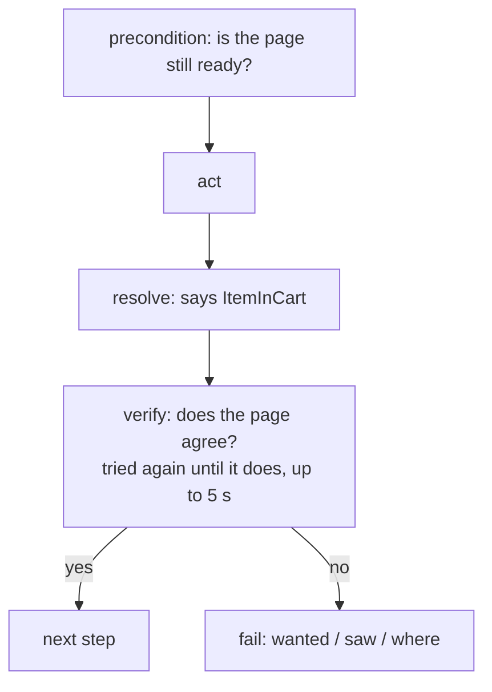

# Checks

A Block says where it landed (`resolve`); its checks (`verify`) prove the page agrees. A check is a **Trait**: one
named thing that holds or doesn't.



## Built-in Traits

| Trait | Holds when |
|---|---|
| `Trait.url({ pathname: "/inventory.html" })` | the URL matches (parts left out match anything, so a query string doesn't matter) |
| `Trait.visible(sel)` | `sel` is visible |
| `Trait.absent(sel)` | nothing matches `sel` |
| `Trait.text(sel, "Saved")` | the text equals, whitespace collapsed |
| `Trait.contains(sel, "Saved")` | the text contains it |
| `Trait.matches(sel, /\d+ items/)` | the text matches |
| `Trait.value(sel, "Ada")` | a field's value equals |
| `Trait.attribute(sel, "aria-pressed", "true")` | an attribute equals |
| `Trait.disabled(sel)` / `Trait.enabled(sel)` | the control is disabled / enabled |
| `Trait.frameVisible` / `frameText` / `frameContains` | the same, inside an iframe |
| `Trait.read(key, test, wants?)` | what the page's Read Block reads passes `test` ([below](#in-the-page-s-own-terms-trait-read)) |

An expected value can come from mem: `Trait.text("#code", (mem) => mem.get(MachineKeys.code))`.

## Where checks go

| Field | When it runs | For |
|---|---|---|
| `verify` | after `resolve` | "did this step do what it says?" |
| `precondition` | right before `act` | "is the page still there?" (a session timeout, a redirect, a popup) |
| Assert Block | as its own step | a state worth naming: "submit is disabled until the form is filled" |
| Layout | after every step that lands on a matching Checkpoint | chrome that should be everywhere (a sidebar) |

`verify` can depend on where the Block landed:

```ts
verify: (out) =>
  out.__state === "LoggedIn" ? [Trait.url({ pathname: "/inventory.html" })] : [Trait.visible(LoginSel.errorBanner)],
```

## Retries, and what a failure says

A check that doesn't hold is tried again every 200 ms until it does or 5 s pass (`timeoutMs` on the Trait changes
that). A page still settling doesn't fail it. When it does fail, it says what it wanted, what the page showed, and
where:

```text
trait "text-equals(.toast, "Saved")" failed after "save-machine":
  wanted "Saved" in .toast; saw "Name is required" (on /equipment/new "Add equipment")
```

The same is data on the run's `step:error` event (`check: { trait, block, wants, saw, url, heading }`), so a script
reading the run log gets it too.

## Your own Trait

```ts
const fiveRows: Trait = {
  name: "five-rows",
  wants: "5 rows",
  async check(page) {
    const n = await page.locator("tr").count();
    return { ok: n === 5, saw: `${n} rows` };   // or just true / false
  },
};
```

`check(page, mem)` also gets mem, so it can check the result of what the step did:

```ts
const removeShownForSelected: Trait = {
  name: "remove-shown-for-selected-item",
  async check(page, mem) {
    return page.locator(DemoSel.removeBtn(mem.get(DemoKeys.selectedItem).id)).isVisible();
  },
};
```

## In the page's own terms: `Trait.read`

With a [Read Block](./reads) on the page, a check can name what the page shows instead of selectors:

```ts
verify: [
  Trait.read(Catalog.items, (items) => items.length === 6, "6 products"),
  Trait.read(Header.cartCount, (n) => n === 1),
],
```

```text
trait "read(catalog.items)" failed after "add-all-to-cart": wanted 6 products; saw [{"name":"Sauce Labs Backpack",…}]
```

## Layouts: one check for many pages

```ts
const AppShell = defineLayout({
  name: "AppShell",
  appliesTo: (tag) => !["LoginPage", "SignedOut"].includes(tag),   // or a list of tags
  verify: [Trait.visible(ShellSel.sidebar)],
});

const engine = new Engine({ ...config, layouts: [AppShell] });
```

Every step that lands on a matching Checkpoint also runs the Layout's `verify`, so the sidebar check can't be
forgotten on one page.

## Empty `verify` is a warning

A Method that moves to another Checkpoint with `verify: []`, or an Assert Block with none, passes every run: it checks
nothing. `waygraph check` warns on it. When the next step is what proves it, say so:
`// waygraph-ignore: empty-verify`.
