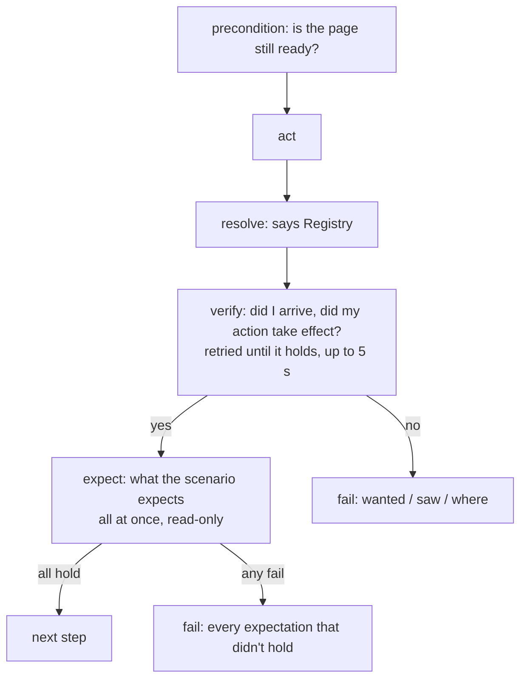

# Checks

Every check answers one of two questions, and each question has one home:

| Question | Where it lives | True | Runs |
|---|---|---|---|
| **Did the step do what it says?** It arrived where `resolve` said; its action took effect. | the Block's `verify` | in every flow that uses the Block | after every run of the Block; never skipped |
| **Is this what the scenario expects?** The toast says *Archived*, the row reads *Down*. | `expect: [...]`: on the Block (what it promises everywhere) or on the step (what only this scenario expects) | in this scenario | right after the step's `verify`; `--no-expect` skips them |



The checks themselves are **Traits**: one named thing that holds or doesn't. Both homes use them.

## Built-in Traits

| Trait | Holds when |
|---|---|
| `Trait.url({ pathname: "/inventory.html" })` | the URL matches (parts left out match anything, so a query string doesn't matter) |
| `Trait.visible(sel)` | `sel` is visible |
| `Trait.absent(sel)` | nothing matches `sel` |
| `Trait.text(sel, "Saved")` | the text equals, whitespace collapsed |
| `Trait.contains(sel, "Saved")` | the text contains it |
| `Trait.matches(sel, /\d+ items/)` | the text matches |
| `Trait.value(sel, "Ada")` | a field's value equals |
| `Trait.attribute(sel, "aria-pressed", "true")` | an attribute equals |
| `Trait.disabled(sel)` / `Trait.enabled(sel)` | the control is disabled / enabled |
| `Trait.frameVisible` / `frameText` / `frameContains` | the same, inside an iframe |
| `Key.is(value)` / `Key.passes((value, mem) => …)` | what the page's [Read Block](./reads) reads for that key equals the value, or passes the test |

An expected value can come from mem: `Trait.text("#code", (mem) => mem.get(MachineKeys.code))`.

## `verify`: the step's own checks

`verify` says the step arrived and its action took effect, true wherever the Block is used. A Nav's `verify` is also how
a live session tells which page it is on, so keep it to what identifies the page.

```ts
defineMethodBlock({
  name: "confirm-archive",
  from: ArchiveConfirm,
  to: Registry,
  instruction: {
    async act(page) { await page.locator(DetailSel.archiveConfirm).click(); },
    verify: [Trait.url({ pathname: "/platform/plant/equipment" })],       // arrived on the list
  },
});
```

`verify` can depend on where the Block landed:

```ts
verify: (out) =>
  out.__state === "LoggedIn" ? [Trait.url({ pathname: "/inventory.html" })] : [Trait.visible(LoginSel.errorBanner)],
```

## `expect`: what the scenario expects

What the scenario expects after a step goes in `expect: [...]`: Expect Blocks (named, reusable), Traits, and `Key.is`.

```ts
export const ExpectArchivedToastBlock = defineExpectBlock({
  name: "expect-archived-toast",
  description: "The toast says the machine was archived.",
  checkpoint: Registry,
  verify: [Trait.text(RegistrySel.toast, "Equipment archived")],
});
```

**On the Block**, when every flow that uses it expects the same thing. A Block that can land in several places lists
them per outcome, each list typed to its own Checkpoint:

```ts
defineMethodBlock({
  name: "submit-machine",
  from: AddMachine,
  to: [MachineDetail, AddMachine],
  expect: { MachineDetail: [ExpectSavedToastBlock], AddMachine: [ExpectFieldErrorsBlock] },
  // ...
});
```

**On the step**, for what only this scenario expects (added to the Block's own):

```ts
engine.map({ as: Planner })
  .gotoPage(Registry.nav, { expect: [Registry.expects.header] })
  .method(Detail.do.confirmArchive, { expect: [ExpectArchivedToastBlock, Machine.status.is("Archived")] })
  .method(Registry.do.sortByName, { expect: [Registry.expects.archivedLast] });
```

| Write | Does |
|---|---|
| `{ expect: [...] }` on a step | adds this scenario's expectations to the Block's |
| `{ expect: false }` on a step | drops the Block's expectations for this step (its `verify` still runs) |
| `.flow(sub, { expect: [...] })` | what this flow expects once the sub-flow is done |
| `map({ expect: false })` | a setup flow nobody is judging: every step's `verify`, no expectations |
| `--no-expect` | the same, for one run |

Live sessions (`pilot`, `auto`, `traverse`) drive the app Block by Block: they run each Block's `verify`, not its
expectations.

### Expectations only read

An expectation reads and judges; it never changes the page or mem. So a step's expectations run **at once**, the step
costs its slowest check, not the sum, and a failing step reports **every** expectation it didn't meet:

```text
2 expectations failed after "confirm-archive" (on /platform/plant/equipment "Equipment")
  - expect-archived-toast › text-equals(.toast, "Equipment archived"): wanted "Equipment archived" in .toast; saw "Saved"
  - read(machine.status): wanted machine.status = "Archived"; saw "Operational"
```

While they run, the page is read-only: a click, a key press, a navigation or `mem.set` in an expectation stops the step,
naming it. If checking needs an action first (reload, open a tab, click to prove nothing opens), that action is a
Method step, and the expectation reads what it left.

### A failure names its step

A failed check says which check, after which step, what it wanted and what the page showed:
`trait "read(catalog.items)" failed after "add-to-cart": wanted the item in the cart; saw [...]`. A failure inside a
step's own action (a click that timed out, a page object's method that threw) names the step the same way, and stays
the error it was (a Playwright `TimeoutError` is still one): `act of "sign-in" failed: locator.click: Timeout 10000ms
exceeded.` The run log's `step:error` keeps the error's own text, beside the step's name.

## Your own Trait

```ts
const fiveRows: Trait = {
  name: "five-rows",
  wants: "5 rows",
  says: "has 5 rows",                            // optional: the demo's ring label, in words, without the selector
  selector: "table",                             // optional: the demo rings it after the step
  async check(page) {
    const n = await page.locator("tr").count();
    return { ok: n === 5, saw: `${n} rows` };   // or just true / false
  },
};
```

`check(page, mem)` also gets mem, to check the result of what the flow did. A check that finds its element at run time
(a row, a toast) names it with `at`, and the demo rings that:

```ts
const machineRowDown: Trait = {
  name: "machine-row-down",
  wants: "the machine's row to read Down",
  async check(page, mem) {
    const row = RegistrySel.rowOf(mem.get(Keys.machine).code);
    const status = await page.locator(`${row} ${RegistrySel.status}`).textContent();
    return { ok: status === "Down", saw: String(status), at: row };
  },
};
```

## A check retries; a failure says why

A check that doesn't hold is tried again every 200 ms until it does or 5 s pass (`timeoutMs` on the Trait changes
that). A page still settling doesn't fail it. When it does fail, it says what it wanted, what the page showed, and
where. The same is data on the run's `step:error` event (`check: { trait, block, when, wants, saw, url, heading }`;
`when` is `"after"` for verify, `"expect"` for an expectation).

## Empty `verify` is a warning

A Method that moves to another Checkpoint with `verify: []`, or an Expect Block with none, passes every run: it checks
nothing. `waygraph check` warns on it, and on checks in the wrong home (see [Blocks](./blocks#lint-it)). When the next
step is what proves it, say so: `// waygraph-ignore: empty-verify`.
