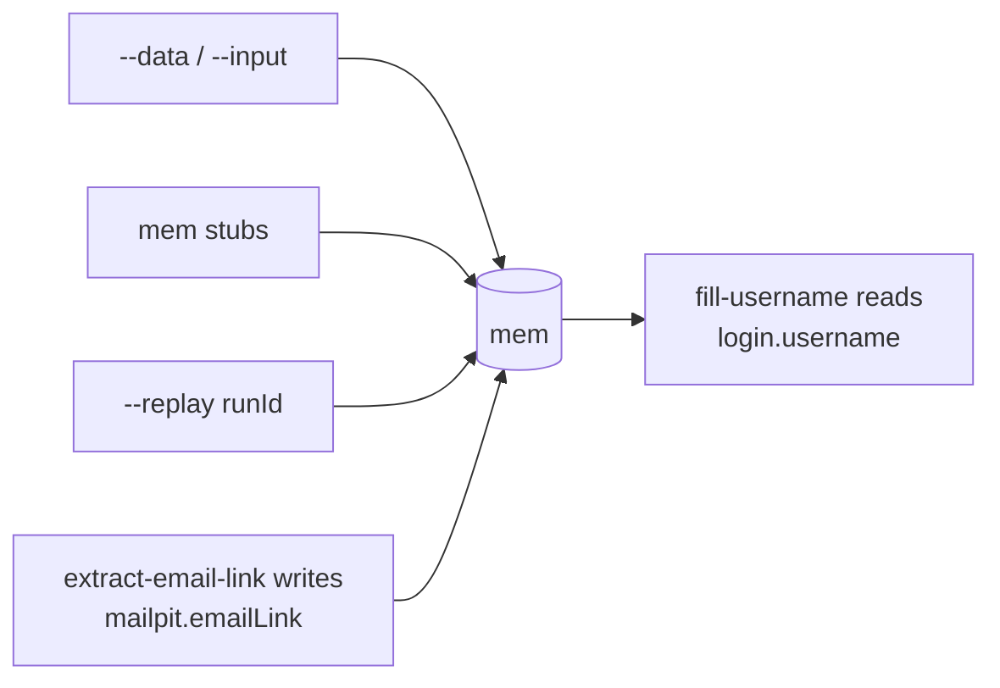

# Data

A run carries its data in **mem**: typed values Blocks read and write by key. A credential, the item being added,
the link read out of an email.



## Declare keys: one namespace, one type

```ts
// src/states/checkout.mem-keys.ts
import { keys } from "waygraph";

export const SaucedemoKeys = keys("saucedemo")<{
  /** Who signs in. */
  credentials: { username: string; password: string };
  /** The catalog row add-to-cart acts on. */
  selectedItem: { id: string; name: string };
}>();
```

Each property is a key named `<namespace>.<field>`: `SaucedemoKeys.credentials` is `saucedemo.credentials`, the name
`--data` and the run log use. Reading it twice gives the same key.

| In a Block | Does |
|---|---|
| `mem.get(SaucedemoKeys.credentials)` | the value, typed; throws when it isn't set |
| `mem.has(SaucedemoKeys.credentials)` | whether it is set |
| `mem.set(SaucedemoKeys.selectedItem, { id, name })` | sets it (type-checked) |
| `requires: [SaucedemoKeys.credentials]` | the Block needs it from outside the flow |

## `requires`: fail before the browser opens

A Block lists the keys a caller must supply in `requires`. Before a tab opens, the run checks every step's `requires`,
so a missing credential fails in milliseconds, naming the key:

```text
preflight: MemPage is missing required key(s) before "submit-login" can run: saucedemo.credentials
```

A key that an earlier step in the same flow writes (the email link) is **not** in `requires`: preflight would reject
the run before that step could write it.

## Supplying values

| From | How |
|---|---|
| the command line | `--data '{"saucedemo.credentials":{"username":"standard_user","password":"secret_sauce"}}'` |
| a flow's input | `--input '{…}'` or `--input @cases.json` |
| a past run | `--replay <runId>` |
| a mem stub | `registerMemStub(key, fake)` in a `*.mem-stubs.ts` file |
| code | `mem.set(key, value)` before `flow.run(mem)` |

`--data` always wins for a key it covers; a stub fills only what is left.

## Mem stubs: fake values

```ts
// src/states/checkout.mem-stubs.ts
import { registerMemStub } from "waygraph";
import { SaucedemoKeys } from "./checkout.mem-keys.js";

registerMemStub(SaucedemoKeys.credentials, () => ({ username: "standard_user", password: "secret_sauce" }));
```

A flow opts in with `map({ memStub: true })`, or one command does with `--mem-stub`. A stub fills only what nothing
else supplied. `auto`, `pilot` and `traverse` load every `*.mem-stubs.ts` under `src/` and use them as defaults.

## Different every run: `unique`

A flow that creates something (a signup, an order) has to pass the second time too. A stub gets `{ unique }`:
different every run and in every parallel worker, the same for every stub within one run:

```ts
registerMemStub(SignupKeys.email, ({ unique }) => `qa+${unique}@example.com`);
registerMemStub(SignupKeys.username, ({ unique }) => `qa-${unique}`);
```

`waygraph check` warns when a create-like Block (`create-`, `signup-`, `register-`, an API Block) requires a key whose
stub returns the same value every time.

## Rerun with the same data

Every run records what it was seeded with (a `run:mem` event in `.waygraph/runs/<runId>.jsonl`), however it got
there: `--data`, a stub, `unique`. Replay it:

```sh
npx waygraph run signupFlow --replay 3f2a9c1e
```

## One flow, many cases

A flow that plays the same steps over different data declares its input instead of one export per case:

```ts
export const addItemFlow = engine
  .map({ as: StandardUser, input: SaucedemoKeys.selectedItem, memStub: true })
  .gotoPage(NavInventoryBlock)
  .method(AddToCartBlock)
  .end();
```

```sh
npx waygraph run addItemFlow --input '{"id":"sauce-labs-onesie","name":"Sauce Labs Onesie"}'
npx waygraph run addItemFlow --input @cases/items.json      # an array: the flow once per item
```

In code: `.flow(addItemFlow, { input: item })`.

## Clean up after yourself

`.finally(Block)` runs after the flow, pass or fail; an API Block is the usual one. A failing cleanup is reported but
never decides whether the flow passed.

```ts
engine.map({ memStub: true })
  .gotoPage(NavSignupBlock)
  .method(SubmitSignupBlock, { lands: SignedUp })
  .finally(DeleteTestUserApiBlock)
  .end();
```

When a rerun can legitimately meet what the last run made, make it an outcome, not a failure: the create Block lands
on `Created` or `AlreadyExists`, and the flow follows the one it's about.

## Mem is not what the page shows

Mem is what a flow is **given** or carries forward. What the page **shows** (the cart count, the rows of a table) is
a [Read Block](./reads): read from the page each time, never stored as a stub.

## Upgrading from `key()`

`key()`, `keyGroup()` and `mem.set(Key(value))` were removed in 0.16.7.

```sh
npx waygraph upgrade --codemod keys
```

rewrites every declaration into namespaces and every use, and lists the names it can't convert (a name that isn't
`<namespace>.<field>`). See [Deprecated](../deprecated).
