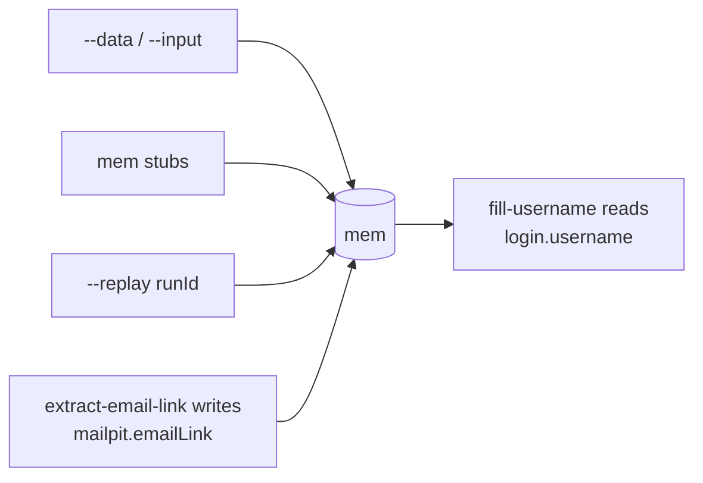

# Data

A run carries its data in **mem**: typed values Blocks read and write by key. A credential, the item being added,
the link read out of an email.



## Declare keys: one namespace, one type

```ts
// src/states/checkout.mem-keys.ts
import { keys } from "waygraph";

export const SaucedemoKeys = keys("saucedemo")<{
  /** Who signs in. */
  credentials: { username: string; password: string };
  /** The catalog row add-to-cart acts on. */
  selectedItem: { id: string; name: string };
}>();
```

Each property is a key named `<namespace>.<field>`: `SaucedemoKeys.credentials` is `saucedemo.credentials`, the name
`--data` and the run log use. Reading it twice gives the same key.

| In a Block | Does |
|---|---|
| `mem.get(SaucedemoKeys.credentials)` | the value, typed; throws when it isn't set |
| `mem.has(SaucedemoKeys.credentials)` | whether it is set |
| `mem.set(SaucedemoKeys.selectedItem, { id, name })` | sets it (type-checked) |
| `requires: [SaucedemoKeys.credentials]` | the Block needs it from outside the flow |

## `requires`: fail before the browser opens

A Block lists the keys a caller must supply in `requires`. Before a tab opens, the run checks every step's `requires`,
so a missing credential fails in milliseconds, naming the key:

```text
preflight: MemPage is missing required key(s) before "submit-login" can run: saucedemo.credentials
```

A key that an earlier step in the same flow writes (the email link) is **not** in `requires`: preflight would reject
the run before that step could write it.

## Supplying values

| From | How |
|---|---|
| the command line | `--data '{"saucedemo.credentials":{"username":"standard_user","password":"secret_sauce"}}'` |
| a flow's input | `--input '{…}'` or `--input @cases.json` |
| a past run | `--replay <runId>` |
| a mem stub | the fake value on the key, where it's declared |
| the flow itself | `.set(key, value)` before the step that reads it ([Flows](./flows#one-block-several-inputs-set)) |
| code | `new MemPage().set(a, 1).set(b, 2)` before `flow.run(context, mem)` |

`--data` always wins for a key it covers; a stub fills only what is left.

## Mem stubs: fake values

```ts
// src/states/checkout.mem-keys.ts
export const SaucedemoKeys = keys("saucedemo")<{ credentials: { username: string; password: string } }>({
  credentials: () => ({ username: "standard_user", password: "secret_sauce" }),
});
```

A flow opts in with `map({ memStub: true })`, every flow from an Engine with `new Engine({ memStub: true })` (the
scaffold's), or one command with `--mem-stub`. A stub fills only what nothing else supplied, and `flow.run()` fills
them itself, so a spec of your own needs no `seedMemStub`. `run`, `demo`, `test`, `auto`, `pilot` and `traverse` load
every `*.mem-keys.ts` themselves: no flow imports one.

## Different every run: `unique`

A flow that creates something (a signup, an order) has to pass the second time too. A stub gets `{ unique }`:
different every run and in every parallel worker, the same for every stub within one run:

```ts
keys("signup")<{ email: string; username: string }>({
  email: ({ unique }) => `qa+${unique}@example.com`,
  username: ({ unique }) => `qa-${unique}`,
});
```

`waygraph check` warns when a Block that makes something (named `create-`, `signup-`, `register-`, or an API Block
that POSTs) requires only keys whose stubs return the same value every time. One key made from `unique` (the
name of what it makes) is enough: a sign-in token next to it is the same every run by design.

## Rerun with the same data

Every run records what it was seeded with (a `run:mem` event in `.waygraph/runs/<runId>.jsonl`), however it got
there: `--data`, a stub, `unique`. Replay it:

```sh
npx waygraph run signupFlow --replay 3f2a9c1e
```

A value made new every run (its stub gives a different one each time, like one made from `unique`) is made new
again: the signup or order it names was made by the first run, and the app would refuse the same one twice. Everything
else (what `--data` gave, a stub that's always the same) is replayed as it was.

## One flow, many cases

A flow that plays the same steps over different data declares its input instead of one export per case:

```ts
export const addItemFlow = engine
  .map({ as: StandardUser, input: SaucedemoKeys.selectedItem, memStub: true })
  .gotoPage(NavInventoryBlock)
  .method(AddToCartBlock);
```

```sh
npx waygraph run addItemFlow --input '{"id":"sauce-labs-onesie","name":"Sauce Labs Onesie"}'
npx waygraph run addItemFlow --input @cases/items.json      # an array: the flow once per item
```

In code: `.flow(addItemFlow, { input: item })`.

## Clean up after yourself

`.finally(Block)` runs after the flow, pass or fail; an API Block is the usual one. A failing cleanup is reported but
never decides whether the flow passed.

```ts
engine.map({ memStub: true })
  .gotoPage(NavSignupBlock)
  .method(SubmitSignupBlock, { lands: SignedUp })
  .finally(DeleteTestUserApiBlock);
```

When a rerun can legitimately meet what the last run made, make it an outcome, not a failure: the create Block lands
on `Created` or `AlreadyExists`, and the flow follows the one it's about.

## States: what the application is

A key is a **state** when its namespace declares it with `state(initial)`: a boolean (signed in) or one of a few words (a role)
the map can reason about. Same file, same autocomplete, same `--data` and run log as any key:

```ts
export const SaucedemoKeys = keys("saucedemo")<{ credentials: { username: string; password: string }; signedIn: boolean }>({
  signedIn: state(false),   // false until something sets it
});
```

A word state is `role: state("guest")`; a page needs one with a pair (`needs: [Keys.role, "admin"]` beside `needs: [Keys.signedIn]`) and a move sets it the same way (`sets: [[Keys.role, "admin"]]`). A page **`needs`** states to be reachable, and a Method or a link **`sets`** them when it lands:

```ts
definePageBlock({ checkpoint: "InventoryPage", needs: [SaucedemoKeys.signedIn], … })        // a shell's `needs` covers every page it covers
self.method({ name: "submit-login", to: ["InventoryPage", "LoginPage"],
  sets: (landed) => (landed.__state === "InventoryPage" ? [[SaucedemoKeys.signedIn, true]] : []) })   // by where it landed
self.link({ to: "LoginPage", click: MenuSel.logout, sets: [[SaucedemoKeys.signedIn, false]] })
```

In a flow with panes, each pane's person has their own states: the account a pane is signed in as brings its states to that pane only, so one signed in is not the other signed in. An account sets the states it brings in its `mem` (`m.set(SaucedemoKeys.signedIn, true)`), because a flow `as` it skips the
login steps. A run applies `sets` after the step lands, records each change as a `step:state` event, then checks the page it landed on:
opening a page that needs `signedIn` while signed out fails the step, naming the state. `waygraph check` walks each flow's steps with the states they set and names a step that lands on a page whose state the flow isn't in, before anything runs (each pane is its own person with its own states). The manifest lists `states`, each page's `needs`
(its own and its shells') and each move's `sets`, and Waygraph Studio draws the lock on a page and a switch per state that dims what
is out of reach.

## Mem is not what the page shows

Mem is what a flow is **given** or carries forward. What the page **shows** (the cart count, the rows of a table) is
the page's [`read`](./reads): read from the page each time, never stored as a stub.

## Upgrading from `key()`

`key()`, `keyGroup()` and `mem.set(Key(value))` were removed in 0.16.7.

```sh
npx waygraph upgrade --codemod keys
```

rewrites every declaration into namespaces and every use, and lists the names it can't convert (a name that isn't
`<namespace>.<field>`). See [Deprecated](../deprecated).
