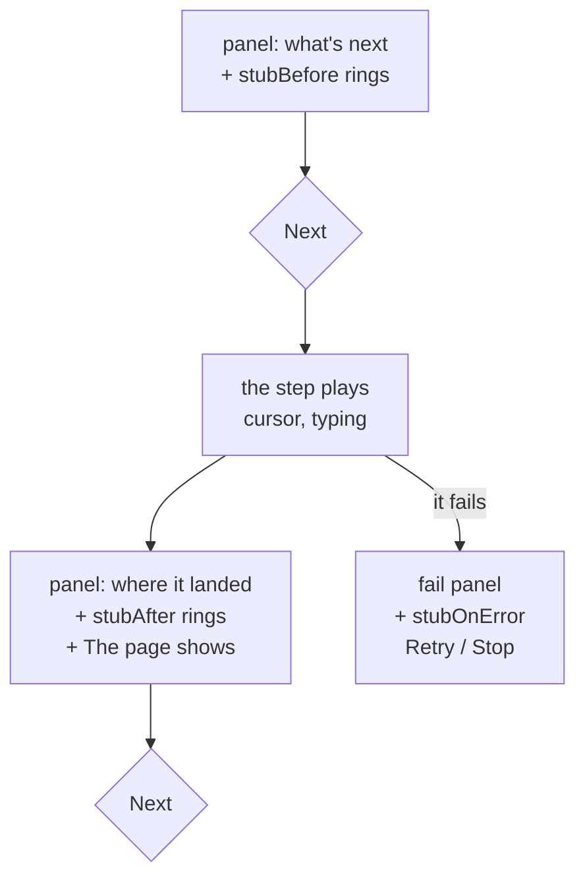

# Demo

`waygraph demo` plays a flow for a person to watch: one step at a time, with the step panel, rings around what each
step touches, captions and a checklist. The flow is the same one `run` and `test` play.

```sh
npx waygraph demo checkoutFlow               # press Next for each step
npx waygraph demo checkoutFlow --auto-next   # advances by itself
npx waygraph demo checkoutFlow --auto-play-video   # unattended, recorded, headless
```

## What one step shows



The after-step panel's **The page shows** section lists every value the page's [Read Block](./reads) read.

## Narration lives in the flow

Blocks stay neutral. A flow narrates a Block where it uses it, by chaining **stubs** on it, so two flows can tell the
same Block's story differently.

```ts
const SubmitLogin = SubmitLoginBlock
  .stubBefore((ctx) => {
    ctx.ui.ring("username", { selector: LoginSel.username, label: "Demo user", detail: "standard_user from mem", tag: "AC" });
    ctx.ui.ring("submit", { selector: LoginSel.loginButton, label: "Sign in", tag: "GATE" });
  })
  .stubAfter((ctx) => ctx.ui.ring("badge", { selector: InventorySel.list, label: "Signed in", tag: "AC", duration: true }));

export const loginFlow = engine
  .map()
  .gotoPage(NavLoginBlock.stubBefore((ctx) => ctx.ui.title("Sign in")))
  .method(FillUsernameBlock)
  .method(FillPasswordBlock)
  .method(SubmitLogin)
  .end();
```

| Stub | Runs | Show |
|---|---|---|
| `stubBefore` | before the step acts | the fields and buttons it will touch |
| `stubAfter` | after it lands and its checks pass | the proof: AC, GATE |
| `stubOnError` | when it fails | what was on screen at the failure |

A stub that throws fails its step, named (`add-item: its stubAfter stub threw: …`), so a typo shows up on the fail
panel instead of the narration quietly missing. A stub is a function of `ctx`: share one like any function
(`src/stubs/`).

## `ctx.ui`

| Call | Paints |
|---|---|
| `ring(id, { selector, label, detail?, tag?, tone?, duration? })` | a ring around an element, with a caption: `[TAG] label - detail` |
| `title("Checkout")` | the banner at the top: the flow's name from this step on |
| `caption("Enter the first name")` / `hideCaption()` | a narration card at the bottom (stays until changed) |
| `todos(id, items, { title, index })` | a floating checklist (acceptance criteria, say) |
| `slides([{ caption, selector?, tone? }, …])` | several captions in turn, each waiting for Next |
| `device("mobile")` / `hideDevice()` | the page at a phone or tablet size, with touch |
| `zoom(1.5)` | zooms the page in |
| `showNetworkTab()` / `hideNetworkTab()` | the network panel: requests, status, bodies, Copy as cURL |

`tone` is `"info"`, `"success"`, `"warning"` or `"danger"`. Blue rings are yours; grey ones are waygraph showing what
a step does on its own (a fill, a click, a check), so the blue stands out.

## Don't hand-write UI

Everything a demo shows goes through `ctx.ui`. Don't build banners or highlight boxes in the page
(`page.evaluate` + `createElement`, `innerHTML`, `addStyleTag`) or restyle waygraph's overlay (`#wg-*`, `.wg-*`):

| Why | Because |
|---|---|
| it changes the page under test | an injected banner can cover a button; a style can hide the bug |
| it breaks silently | overlay ids and classes are internal and change between releases |
| it already exists | `ctx.ui` covers it, and survives navigation |

`waygraph check` warns on it (`hand-written-ui`). If `ctx.ui` is missing something, that's a feature to ask for.

## The checklist

`ctx.ui.todos` floats beside the panel. By default it folds to about five rows around the current one, moves to the
other side when a ring would sit under it, and dims while a ring is up.

| Turn off | With |
|---|---|
| all three, for the run | `--todo-full` |
| one, for one step | `ctx.ui.todoDockUi({ compact: false, collision: false, behindRing: false })` |
| pin a side | `--todo-left` / `--todo-right` |

## Pace

| Setting | Where |
|---|---|
| the whole demo | `--fast`, or `demo: { pace: "fast" }` in the config |
| one flow | `map({ demoPace: "slow" })` |
| one step | `.method(SetBearerTokenBlock, { pace: "blitz" })` (no typing animation, no pause) |
| a group of steps | `{ ff: true }` on each, or `fastForwardComposeBlock`: one panel, full speed |

Paces are `"blitz"`, `"fast"`, `"normal"`, `"slow"`, or a number (`0.5` = twice as fast; above `20` it's milliseconds).
`--ff-disabled` opens every fast-forward group up into its steps, to see which one broke.

## Flags

| Flag | Does |
|---|---|
| `--auto-next` | advances by itself |
| `--fast` | shorter pauses and cursor moves |
| `--full` | every step as a chip, instead of the carousel |
| `--video [dir]` | records a `.webm` (default `~/Downloads/waygraph-videos/<project>`) |
| `--auto-play-video` | `--auto-next --video`, headless |
| `--auto-play-video-head` | the same, with the browser visible |
| `--data` / `--input` / `--replay` | the flow's data ([Data](./data)) |

`waygraph demo --help` prints every flag; [environment variables](../env) lists what each one sets.
`demo.appearance: "light" | "dark"` in the config pins the overlay's look, so recordings match whichever machine
makes them.
