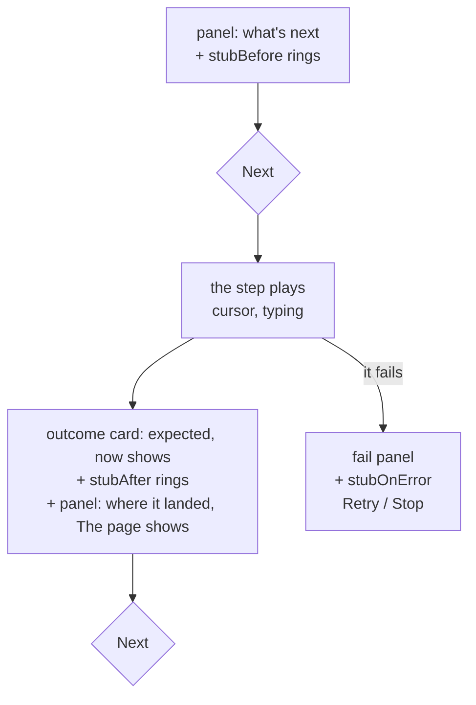

# Demo

`waygraph demo` plays a flow for a person to watch: one step at a time, with the step panel, rings around what each
step touches, captions and a checklist. The flow is the same one `run` and `test` play.

```sh
npx waygraph demo checkoutFlow               # press Next for each step
npx waygraph demo checkoutFlow --auto-next   # advances by itself
npx waygraph demo checkoutFlow --auto-play-video   # unattended, recorded, headless
```

## What one step shows



The before-step panel lists what the step expects (`expect: [...]`). After it:

- The **outcome card** (above the step panel, shown whether the panel is open or not) says how the step went: under
  **Expected**, each expectation in words (an Expect Block's description), ticked in turn, or crossed with what the
  page showed; under **Now shows**, what the page's [Read Block](./reads) reads that changed since the step before
  (`cart.count 0 > 1`; a list by its size). A failed step shows the card next to its fail panel.
- The rings show what the step's checks looked at, labelled in words: an expectation's description, or what the check
  looked for (`shows`, `reads "Saved"`; a custom Trait's `says`). Something no longer on the page (a check made before
  the step went to another page) gets no ring.
- Its Expect Blocks' own narration plays: its slides, then its rings, a case's to-do marked, a caption.
- The panel's **The page shows** section lists every value the page's Read Blocks read.

## Narration lives in the flow

Blocks stay neutral. A flow narrates a Block where it uses it, by chaining **stubs** on it, so two flows can tell the
same Block's story differently.

```ts
const SubmitLogin = SubmitLoginBlock
  .stubBefore((ctx) => {
    ctx.ui.ring("username", { selector: LoginSel.username, label: "Demo user", detail: "standard_user from mem", tag: "AC" });
    ctx.ui.ring("submit", { selector: LoginSel.loginButton, label: "Sign in", tag: "GATE" });
  })
  .stubAfter((ctx) => ctx.ui.ring("badge", { selector: InventorySel.list, label: "Signed in", tag: "AC", duration: true }));

export const loginFlow = engine
  .map()
  .gotoPage(NavLoginBlock.stubBefore((ctx) => ctx.ui.title("Sign in")))
  .method(FillUsernameBlock)
  .method(FillPasswordBlock)
  .method(SubmitLogin);
```

| Stub | Runs | Show |
|---|---|---|
| `stubBefore` | before the step acts | the fields and buttons it will touch |
| `stubAfter` | after it lands and its checks pass | the proof: AC, GATE |
| `stubOnError` | when it fails | what was on screen at the failure |

A stub that throws fails its step, named (`add-item: its stubAfter stub threw: …`), so a typo shows up on the fail
panel instead of the narration quietly missing. A stub is a function of `ctx`: share one like any function
(`src/stubs/`).

## `ctx.ui`

| Call | Paints |
|---|---|
| `ring(id, { selector, label, detail?, tag?, tone?, duration? })` | a ring around an element, with a caption: `[TAG] label - detail` |
| `title("Checkout")` | the banner at the top: the flow's name from this step on |
| `caption("Enter the first name")` / `hideCaption()` | a narration card at the bottom (stays until changed) |
| `todos(id, items, { title, index })` | a floating checklist (acceptance criteria, say) |
| `slides([{ caption, selector?, tone? }, …])` | several captions in turn, each waiting for Next |
| `device("mobile")` / `hideDevice()` | the page at a phone or tablet size, with touch |
| `zoom(1.5)` | zooms the page in |
| `showNetworkTab()` / `hideNetworkTab()` | the network panel: requests, status, bodies, Copy as cURL |

When the steps end, the overlay clears and a card says the demo is done and how it went: **Finished** (or **Finished as
expected**, for a flow that's meant to fail), or **Stopped** with the step and the reason; the flow's title, and how
many steps in how long. It stays a moment (a short one with `--fast`) before the page closes, so a recording ends on it.

The step panel, the banner, the caption, the checklist, the device and the outcome card stay through a navigation: a
step that goes to another page or site (a redirect, a login, a payment provider) shows them there as they were, until a
stub changes them.

`tone` is `"info"`, `"success"`, `"warning"` or `"danger"`. Blue rings are yours; grey ones are waygraph showing what
a step does on its own (a fill, a click, a check), so the blue stands out.

## Don't hand-write UI

Everything a demo shows goes through `ctx.ui`. Don't build banners or highlight boxes in the page
(`page.evaluate` + `createElement`, `innerHTML`, `addStyleTag`) or restyle waygraph's overlay (`#wg-*`, `.wg-*`):

| Why | Because |
|---|---|
| it changes the page under test | an injected banner can cover a button; a style can hide the bug |
| it breaks silently | overlay ids and classes are internal and change between releases |
| it already exists | `ctx.ui` covers it, and survives navigation |

`waygraph check` warns on it (`hand-written-ui`). If `ctx.ui` is missing something, that's a feature to ask for.

## The checklist

`ctx.ui.todos` floats beside the panel. By default it folds to about five rows around the current one, moves to the
other side when a ring would sit under it, and dims while a ring is up.

| Turn off | With |
|---|---|
| all three, for the run | `--todo-full` |
| one, for one step | `ctx.ui.todoDockUi({ compact: false, collision: false, behindRing: false })` |
| pin a side | `--todo-left` / `--todo-right` |

## Pace

| Setting | Where |
|---|---|
| the whole demo | `--fast`, or `demo: { pace: "fast" }` in the config |
| one flow | `map({ demoPace: "slow" })` |
| one step | `.method(SetBearerTokenBlock, { pace: "blitz" })` (no typing animation, no pause) |
| a group of steps | `{ ff: true }` on each, or `fastForwardComposeBlock`: one panel, full speed |

Paces are `"blitz"`, `"fast"`, `"normal"`, `"slow"`, or a number (`0.5` = twice as fast; above `20` it's milliseconds).
`--ff-disabled` opens every fast-forward group up into its steps, to see which one broke.

## Voice-over

A recorded demo (`--video`) can speak its narration. Give the demo a voice in the config, and each caption and slide is
spoken as it shows; the recording gets the speech as its audio track and its subtitles beside it (`<video>.vtt`):

```ts
// config/waygraph.config.ts
import { defineConfig, kokoroVoice } from "waygraph";

const config = defineConfig({
  baseUrl: "https://www.saucedemo.com",
  demo: {
    voice: {
      speaker: kokoroVoice(), // af_heart; kokoroVoice({ voice: "am_michael", speed: 0.95 })
      steps: true,            // also each step's description
    },
  },
});
```

```sh
npx waygraph extensions install        # once per machine: Kokoro and its model (~350 MB, in waygraph's cache)
npx waygraph demo checkoutFlow --auto-play-video
# waygraph: voice-over: 14 lines, subtitles .../page@8c26....vtt
```

The voice is heavy (a model), so it isn't part of waygraph's install, and the waygraph package stays as it was:
`waygraph extensions install` sets it up for every project on the machine, next to the browser extensions, the same
way: named in the config, fetched by one command, `--update` to fetch it again.

| | |
|---|---|
| Where | `~/.cache/waygraph/voices/kokoro/` (`WAYGRAPH_CACHE_DIR` moves it): a Python environment (`venv/`, ~150 MB), the model (`kokoro-v1.0.onnx`, 326 MB), its voices (`voices-v1.0.bin`, 28 MB), and `installed.json`, what was set up. One copy for every project |
| Not set up yet | `waygraph demo --video` records without the voice-over and says, once, `recording without the voice-over: Kokoro isn't set up on this machine: run waygraph extensions install`. Nothing fails; only `--video` demos ever speak |
| A new waygraph, a new Kokoro | Each waygraph pins the Kokoro it speaks with (the package version and the model release). After an upgrade that moves it, a recording says `the Kokoro on this machine is another version than this waygraph uses`; `waygraph extensions install` replaces it (the environment again, a new model downloaded, the old one removed). Lines already spoken are cached by voice and model, so a new model makes them again |

| Speaker | |
|---|---|
| `kokoroVoice()` | [Kokoro](https://huggingface.co/hexgrad/Kokoro-82M), natural and local (CPU is enough). Its model is loaded once and kept for the recording. `waygraph extensions install` sets it up (a Python environment through [uv](https://docs.astral.sh/uv/) when there is one, and the model); or name your own `python`, `model` and `voices`. Voices: `af_heart` (default), `af_bella`, `am_michael`, `bf_emma`... |
| `commandVoice("piper --model x.onnx --output_file {out}")` | a local text-to-speech command: `{out}` is the file it writes, `{text}` the line (without `{text}`, the line goes to its stdin). [piper](https://github.com/OHF-Voice/piper1-gpl) sounds natural and runs offline; `espeak-ng -w {out} {text}` is on most Linux machines; on macOS, `say -o {out} --data-format=LEI16@22050 {text}` |
| `openAIVoice({ voice: "nova", instructions: "Calm and clear." })` | an OpenAI-compatible speech API (`OPENAI_API_KEY`, or `apiKey`; `baseURL` for another server that speaks the same API, a local one too) |
| your own | `{ id, ext, synthesize(text, out) }`: write `text`, spoken, to the file `out` |

- **What's spoken:** a new caption (`ctx.ui.caption`) as it shows, each slide (its caption, then its detail) and, with
  `steps: true`, each step's description as its panel comes up. A caption painted again unchanged isn't spoken again.
  Arrows and separators are read as words (`Cart -> info` is "Cart to info"); the screen shows them as written.
- **Timing:** lines are spoken one at a time, never over each other, with a breath between them, and auto-advance waits
  for a line to end before moving on, so the voice is never cut off. A slow voice makes a longer video, not a clipped
  one. With `steps: true`, the steps' descriptions are made while the first steps play, so a first recording doesn't
  stop to make them.
- **Cache:** each line is made once per voice and text, in `.waygraph/voice/`; a second recording of the same flow
  doesn't call the voice again.
- **Needs ffmpeg** (and ffprobe) on the PATH. Without it the demo records silent and says why. A line the voice fails
  on is left out, naming it; the rest are kept.

Only a recorded demo speaks: `waygraph run` shows no narration, and a demo without `--video` has nothing to put the
speech on. `--no-voice` records without it.

## Flags

| Flag | Does |
|---|---|
| `--auto-next` | advances by itself |
| `--fast` | shorter pauses and cursor moves |
| `--full` | every step as a chip, instead of the carousel |
| `--video [dir]` | records a `.webm` (default `~/Downloads/waygraph-videos/<project>`) |
| `--auto-play-video` | `--auto-next --video`, headless |
| `--auto-play-video-head` | the same, with the browser visible |
| `--no-voice` | records without the config's voice-over |
| `--data` / `--input` / `--replay` | the flow's data ([Data](./data)) |

`waygraph demo --help` prints every flag; [environment variables](../env) lists what each one sets.
`demo.appearance: "light" | "dark"` in the config pins the overlay's look, so recordings match whichever machine
makes them.
