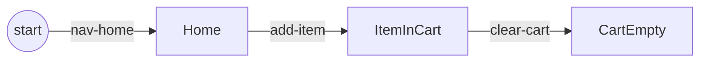
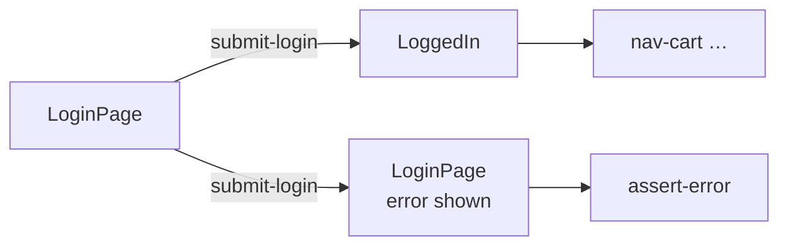
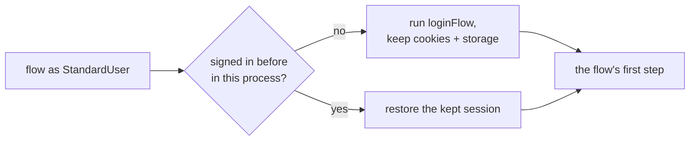

# Flows

A flow is a path through your Blocks, written with `engine.map()`. TypeScript checks that each step starts where the
last one ended, so a flow can't skip from one page to an unrelated one. The chain is the flow: there is no closing call, and
whatever the chain holds when you export it, runs.



```ts
import { engine } from "#config/waygraph.config";
import { HomePage } from "#map/(app_base)/home/_page.block";

export const homeCartFlow = engine
  .map()
  .gotoPage(HomePage.nav)
  .method(HomePage.do.addItem)
  .assert(HomePage.do.assertItemAdded)
  .method(HomePage.do.clearCart);
```

A flow imports one thing per page it visits: the page's Page Block, whose `nav` opens it and whose `do` holds what you
can do there ([Blocks](./blocks#page-blocks)). `#config/` and `#map/` are the project's own short paths
([Project](./project#imports)).

## The steps

Each step takes the kind of Block its name says. Hand it anything else, or an object that only looks like a Block,
and it throws, naming the factory to use.

| Step | Takes |
|---|---|
| `.gotoPage(b)` | a Nav or Page Block on your app |
| `.gotoExternal(b)` | a Nav Block on another site (a mail catcher, a REST client) |
| `.method(b)` | a Method, Effect or API Block |
| `.assert(b)` | an Assert Block |
| `.expect(key, want)` | a check on what the page shows, in place: `want` is a value, or a test that gets the value and mem |
| `.set(key, value)` | sets a mem key for the steps after it: a value, or one worked out from mem |
| `.steps(part)` | a part made with `steps()`: the same steps in several flows |
| `.flow(sub, { reset })` | another flow's steps, in the same page and mem |
| `.branch({ Tag: (m) => … })` | a different continuation for each place the last step can land |
| `.finally(b)` | a cleanup step: runs after the others, pass or fail |

## Step options

The second argument tunes one step:

| Option | Does | Example |
|---|---|---|
| `lands` | the outcome this flow is about, when a Block can land in several | `.method(SubmitLoginBlock, { lands: LoggedIn })` |
| `settle` | waits for a page that keeps changing (a debounced search) | `{ settle: true }` or `{ settle: { quietMs: 600, maxMs: 8000 } }` |
| `when` | plays the step only if it returns true (an optional field) | `{ when: (mem) => mem.get(Case.body) !== undefined }` |
| `pace` | demo speed for this step | `{ pace: "blitz" }` |
| `ff` | fast-forwards this one step in the demo; for several, `.ffStart()` … `.ffEnd()` | `{ ff: true }` |

A run where the Block lands somewhere other than `lands` fails at that step:
`"submit-login" landed on LoginPage, but this flow continues from LoggedIn`.

## Checking what the page shows: `.expect()`

A check on one value doesn't need an Assert Block of its own. `.expect` reads the key through the page's
[Read Block](./reads), retried until the page settles like every check:

```ts
engine.map()
  .gotoPage(MachinePage.nav)
  .expect(Machine.status, "Down")                                            // equal (deep, for lists and objects)
  .expect(Machine.code, (code, mem) => code === mem.get(Keys.machine).code, "the machine we logged");
```

A failure says what it wanted and saw: `wanted machine.status = "Down"; saw "Operational"`. Write an Assert Block when
the check has a name worth reusing, or needs selectors.

## One Block, several inputs: `.set()`

A Block reads its input from mem, so the flow can say what it is right before the step. One Fill Block covers every
search instead of one Block per value:

```ts
engine.map()
  .gotoPage(RegistryPage.nav)
  .set(Keys.search, "MCH-0111")
  .method(RegistryPage.do.fillSearch)
  .set(Keys.search, (mem) => mem.get(Keys.downMachine).code)                 // worked out when the step runs
  .method(RegistryPage.do.fillSearch);
```

A key a `.set()` gives is no longer one the run must supply: `--data` and mem stubs aren't asked for it.

## The same steps in several flows: `steps()`

```ts
export const logDisruption = steps(DisruptionLog, (m) =>
  m.method(LogPage.do.selectMachine).method(LogPage.do.fillShiftStart).method(LogPage.do.submit),
);

engine.map({ as: Planner })
  .gotoPage(LogPage.nav)
  .steps(logDisruption)
  .gotoPage(LogPage.nav)
  .steps(logDisruption);
```

A part is typed from the Checkpoint it starts on, like any step: played from anywhere else, it doesn't compile. It
isn't a flow on its own; the flow that plays it is. For signing in, use an [account](#accounts) instead.

## Before and after: setup and cleanup

Data a flow needs goes in first, as steps (an API Block, or a whole flow), so the flow doesn't depend on what the
database happens to hold; what it made goes away in `.finally()`, pass or fail:

```ts
engine.map({ as: Planner })
  .flow(seedDownMachineFlow)          // API Blocks: create the machine, keep its code in mem
  .gotoPage(RegistryPage.nav)
  .expect(Registry.rows, (rows, mem) => rows.some((r) => r.code === mem.get(Keys.downMachine).code))
  .finally(DeleteMachineApiBlock);
```

## Two outcomes: `lands` or `.branch()`



```ts
engine.map()
  .gotoPage(NavLoginBlock)
  .method(SubmitLoginBlock)
  .branch({
    LoggedIn: (m) => m.gotoPage(NavCartBlock),
    LoginPage: (m) => m.assert(AssertLoginErrorBlock),
  });
```

`.branch()` must name every outcome (`null` ends that one there). Use `lands` when the flow is only about one.

## Flow settings

`map({ … })` sets the flow up before its first step:

| Setting | Does |
|---|---|
| `memStub: true` | fills keys nothing else supplies from their mem stubs ([Data](./data)); `new Engine({ memStub: true })` does it for every flow |
| `as: Account` | starts signed in as that account ([below](#accounts)) |
| `input: Key` | the flow takes this key as its input, once per case ([Data](./data#one-flow-many-cases)) |
| `viewport: { width, height }` | the browser size it plays at |
| `timezone` / `network` | the world it runs in ([Testing](./testing#the-world-a-flow-runs-in)) |
| `exclusive: true` | `test --flows` runs it alone, after the others |
| `sessionReset: true` | starts with fresh cookies and storage when it follows another flow |
| `expectedFailure: "why"` | the flow is meant to fail (a locked-out user); passes when it does |
| `demoPace`, `highlightStyle` | demo speed and ring style ([Demo](./demo)) |
| `homeOrigin` | checks each Nav's URL is on this origin (`gotoExternal` checks it isn't) |

## Accounts

A flow that starts signed in says as whom. An account is a name and the flow that signs it in:

```ts
// src/accounts/accounts.ts
export const StandardUser = account("standard-user", { signIn: loginFlow });

// src/flows/cart-as-account.flow.ts
export const cartAsAccountFlow = engine
  .map({ as: StandardUser })
  .gotoPage(NavInventoryBlock)
  .method(AddToCartBlock);
```



So a test run signs each account in once. `forgetSessions()` drops the kept sessions.

## Episodes: nesting flows

```ts
export const showcase = engine
  .map()
  .flow(ownerFlow)                       // episode 1
  .flow(viewerFlow, { reset: true })     // episode 2: a second user, fresh cookies;
```

## Running a flow

| How | Command |
|---|---|
| headless | `npx waygraph run homeCartFlow` (or the file: `src/flows/home/cart.flow.ts`) |
| step by step, narrated | `npx waygraph demo homeCartFlow` ([Demo](./demo)) |
| as a test | `npx waygraph test --flows` ([Testing](./testing)) |
| two in a row | `npx waygraph run "loginFlow then shopFlow"` |
| list them | `npx waygraph list` |
| in code | `await flow.run(new MemPage())` (own browser) · `await flow.run(context, new MemPage().set(Keys.user, marco))` (a Playwright test's context) |

`flow.run(context, mem, { page, closeOnFinish: false })` drives a page you already have and hands it back:
[recipes](../reference/cli#recipes).
