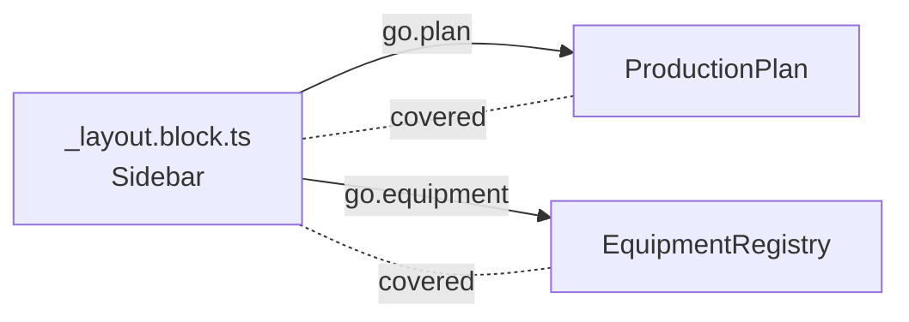

# Layouts

Most apps wrap their pages in shared UI: a sidebar, a top bar, a user menu, breadcrumbs. Front-end frameworks declare it
once, in a layout file beside the pages it wraps. waygraph does the same: a **layout** is declared once, in a
`_layout.block.ts`, and its links and actions are there on every page it covers.



## Declare it

```ts
// src/map/(app_base)/platform/_layout.block.ts
import { defineLayout, Trait } from "waygraph";
import { Admin, Planner } from "../../../accounts/accounts.js";
import { EquipmentRegistry, ProductionPlan } from "../../../states/app.states.js";
import { SidebarSel } from "./_sel.js";

export const Sidebar = defineLayout({
  name: "sidebar",
  go: {
    plan: { to: ProductionPlan, click: SidebarSel.plan },
    equipment: { to: EquipmentRegistry, click: SidebarSel.equipment, for: [Admin], verify: [Trait.visible(SidebarSel.heading)] },
    up: { to: "parent", click: SidebarSel.backCrumb },
  },
  do: { signOut: () => SignOutBlock },
  read: (ctx) => SidebarShows({ links: ctx.page.list(SidebarSel.link, (link) => link.text()) }),
});
```

A layout is a hub like a Page Block, not a step of its own:

- `Sidebar.go.<name>` are Navs: `.gotoPage(Sidebar.go.equipment)`.
- `Sidebar.do.<name>` are Methods (`() => Block`, lazy, as a page's `do` is): `.method(Sidebar.do.signOut)`.
- `read` is what the layout shows on every page it covers (a reader per field, as a page's `read`); `Sidebar.read.links` is its typed key. `readAs` names it in the run log; the layout's name by default.

## Interrupts: what appears and gets in the way

A cookie banner, a "your session expires" warning, a survey: they show up on any page of the layout, at any moment, and
cover what a step is about to click. A layout names each and what to do about it:

```ts
export const Shell = defineLayout({
  name: "shell",
  interrupts: {
    cookies: { when: "#cookie-banner", do: (page) => page.getByRole("button", { name: "Accept" }).click() },
  },
});
```

While a step runs on a page the layout covers, whichever step is running isn't blocked: when `when` shows, `do` runs and
the step goes on (Playwright's locator handlers, installed per page). The run log gets an `interrupt` event, and the demo's
card after the step says "Handled on the way: shell: cookies". It is not a step and not a failure; a flow never mentions it.

## What it covers

A layout covers the pages whose Nav or Page Block is in its folder or below: the same pages the framework's layout
wraps. A nested layout (`platform/plant/_layout.block.ts`) covers its own folder, and its pages are under both.

When an app's layout doesn't follow its addresses (saucedemo's burger menu is on every page but the login page, and they
all share one folder), `on` names the pages instead:

```ts
export const Menu = defineLayout({ name: "menu", on: [InventoryPage, CartPage /* … */], opens: MenuSel.button, go: { /* … */ } });
```

`opens` is the button that shows a menu that hides its links: a link clicks it first when the link isn't in the window.

A link type-checks from any page. When it runs, it checks first that the page the flow is on is one the layout covers,
and fails before clicking, naming the layout and the page:

```
menu-logout: check "on-menu" didn't pass before it acted
  wanted  a page menu is on (InventoryPage, ItemDetailPage, CartPage, …)
  saw     LoginPage: menu isn't on it, so menu › logout can't be clicked there
```

Route finding (`waygraph auto`, chains, the graph) plans with the pages each link runs from.

## Breadcrumbs

A link with `to: "parent"` goes to the page above the one it starts on, in the site map (the nearest page whose address
this page's extends): one declaration for every page the layout covers. `Trait.breadcrumbs(sel)` checks that the crumbs
lead to the pages above this one, in order, by their addresses, and names a missing or extra one:

```ts
verify: [Trait.breadcrumbs(CrumbsSel.link)]
// saw  missing /platform/plant
```

## Who sees what: `for`

`for: [accounts]` says who is given something; without it, everyone. It goes on a layout's links, on Methods (who has
the button) and on Page Blocks (who can open the page). It takes `account(...)` values, so a typo is a type error.

```ts
export const EquipmentRegistryPage = definePageBlock({ name: "equipment-registry", checkpoint: EquipmentRegistry, url: "/equipment", for: [Admin] });
export const AddMachineBlock = defineMethodBlock({ name: "add-machine", from: EquipmentRegistry, to: EquipmentRegistry, for: [Admin], async act(page) { /* … */ } });
```

- `waygraph test --flows` adds one **access test** per account (`access › planner`, tagged `@access @planner`): signed
  in as it, each layout shows exactly the links it's given, and each page it isn't given doesn't open. See
  [Testing](./testing#access-tests).
- `waygraph check` flags a flow that runs as an account (`map({ as })`) and uses a link, Method or page that account
  isn't given.
- Waygraph Studio draws a layout once, with a line to each page its links lead to, and can show the map as one account sees
  it. See [Waygraph Studio](./studio).

## In a page or in a layout?

- On one page: the page's Page Block (`do`, `nav`, its `read`).
- On many pages, the same: a layout. Never a list of pages on each Nav, and never the same Method on each page.
- Who sees it: `for`, beside what it's about. A role is the accounts that share a `for`.
