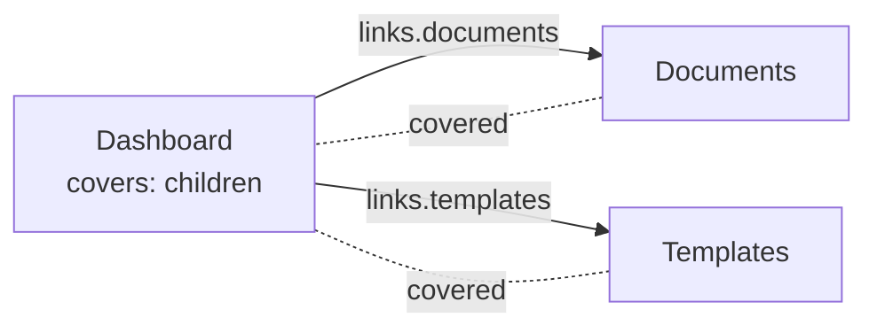

# Layouts: a page that covers pages

Most apps wrap their pages in shared UI: a sidebar, a top bar, a user menu, a cookie banner. Waygraph has no separate
layout kind for it. A Page Block can **cover** other pages, as a superstate does in a statechart: what it declares is valid
on every page it covers, and the map draws it as one box around them.



## Declare it

```ts
// src/map/(app_base)/dashboard/_page.block.ts: the dashboard is a page, and the shell of everything below it
export const Dashboard = definePageBlock({
  name: "page-dashboard",
  checkpoint: "Dashboard",
  route: "folder",
  covers: "children",

  // links valid on every covered page: one declaration instead of a Nav per page
  links: (self) => ({
    documents: self.link({ to: "Documents", click: Sel.documents }),
    templates: self.link({ to: "Templates", click: Sel.templates, for: [Admin] }),   // who sees it
    up: self.link({ to: "parent", click: Sel.backCrumb }),                           // the page above, in the site map
  }),
  // what every covered page shows
  read: (ctx) => ({ user: ctx.page.text(Sel.userMenu) }),
  // what can appear on any of them
  interrupts: { sound: { when: Sel.soundModal, do: (page) => page.locator(Sel.notNow).click() } },
});
```

- **Names complete and typos are errors.** `to` and `covers` take the project's page names: `waygraph types` writes them to
  `src/waygraph-pages.d.ts` (a global `WaygraphPages` interface, as a framework types its routes), and `waygraph typecheck` and
  `check` rewrite it first. Commit it. Until it exists, any name is accepted. Add a page, run `waygraph typecheck`, and the
  new name completes.
- `Dashboard.links.documents` is a Nav: `.gotoPage(Dashboard.links.documents)` from any covered page, typed, with
  autocomplete on the link names.
- `covers: "children"` is every page under the folder (nested shells stack). `covers: ["Documents", "Templates"]` names
  pages wherever they live (saucedemo's burger menu is on every page but the login page, which shares its folder).
- A shell with no page of its own leaves out `checkpoint`: `definePageBlock({ name: "menu", covers: [...], links })`.
- `opens: Sel.menuButton` is the button of a menu that hides its links: a link clicks it first when it isn't in the window.
- `read` is read on every covered page; its keys are `Dashboard.read.user`, `readAs` names it in the run log.

A link type-checks from any page. When it runs, it checks first that the page the flow is on is one the shell covers, and
fails before clicking, naming both:

```
menu-logout: check "on-menu" didn't pass before it acted
  wanted  a page menu is on (InventoryPage, ItemDetailPage, CartPage, …)
  saw     LoginPage: menu isn't on it, so menu › logout can't be clicked there
```

Route finding (`waygraph auto`, chains, the graph) plans with the pages each link runs from.

## Interrupts: what appears and gets in the way

A cookie banner, a "your session expires" warning, a survey: they show up on any covered page, at any moment, and cover
what a step is about to click. `interrupts` on the shell names each and what to do about it. While a step runs on a
covered page, whichever step is running isn't blocked: when `when` shows, `do` runs and the step goes on (Playwright's
locator handlers, installed per page). The run log gets an `interrupt` event, and the demo's card after the step says
"Handled on the way: shell: cookies". It is not a step and not a failure; a flow never mentions it.

A page in an iframe says `frame` on its own Page Block (see [Blocks](./blocks#page-blocks)), not on the shell.

## Breadcrumbs

A link with `to: "parent"` (`self.link({ to: "parent", … })`) goes to the page above the one it starts on, in the site map (the nearest page whose address
this page's extends): one declaration for every page the layout covers. `Trait.breadcrumbs(sel)` checks that the crumbs
lead to the pages above this one, in order, by their addresses, and names a missing or extra one:

```ts
verify: [Trait.breadcrumbs(CrumbsSel.link)]
// saw  missing /platform/plant
```

## Who sees what: `for`

`for: [accounts]` says who is given something; without it, everyone. It goes on a layout's links, on Methods (who has
the button) and on Page Blocks (who can open the page). It takes `account(...)` values, so a typo is a type error.

```ts
export const EquipmentRegistryPage = definePageBlock({ name: "equipment-registry", checkpoint: "EquipmentRegistry", url: "/equipment", for: [Admin] });
export const AddMachineBlock = defineMethodBlock({ name: "add-machine", from: EquipmentRegistry, to: EquipmentRegistry, for: [Admin], async act(page) { /* … */ } });
```

- `waygraph test --flows` adds one **access test** per account (`access › planner`, tagged `@access @planner`): signed
  in as it, each layout shows exactly the links it's given, and each page it isn't given doesn't open. See
  [Testing](./testing#access-tests).
- `waygraph check` flags a flow that runs as an account (`map({ as })`) and uses a link, Method or page that account
  isn't given.
- Waygraph Studio draws a shell once, with a line to each page its links lead to, and can show the map as one account sees
  it. See [Waygraph Studio](./studio).

## In a page or in a shell?

- On one page: the page's own Page Block (`do`, `read`, `expects`).
- On many pages, the same: a page that covers them. Never a list of pages on each Nav, and never the same link on each page.
- Who sees it: `for`, beside what it's about. A role is the accounts that share a `for`.
