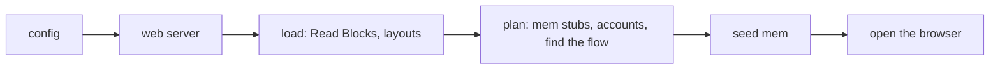
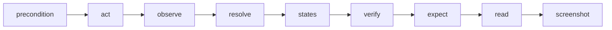

# How a run works

What happens, in order, from `waygraph run checkoutFlow` to the last step. Knowing this tells you *when* your code runs:
when a file is imported, when a Block's functions are called, and why some things are written as `() => Block`.

## 1. Loading (once per run)



1. **The config** (`config/waygraph.config.ts`) is read first, and what it resolves to becomes environment (`baseUrl`,
   `device`, the demo's settings). Flags beat it.
2. **The web server** the config names starts, if any.
3. **Loading.** `waygraph` imports, by scanning the project: pages with their reads, the pages that cover others (which works out
   which pages each covers), then, while planning, mem stubs (on the keys, `*.mem-keys.ts`) and accounts (`src/accounts/`). Nothing
   imports these for their side effect: they register themselves when imported, and waygraph imports them.
4. **Planning** finds the flow (an export of a `*.flow.ts`, a file, or a chain `a then b`), turns it into steps, and
   seeds mem from `--data`, mem stubs or a replay.
5. **The browser opens** (your config's device, extensions, video), then the first step.

**Import time vs run time.** A file's top level runs *once, when it's imported*: `definePageBlock(...)`,
`defineMethodBlock(...)`, `engine.map()...` all run then, to *build* values. Their `act`, `verify`, `read` and `call`
functions run later, during steps. So a flow's chain is built (and type-checked, and its Blocks' kinds checked) at
import, before any browser exists.

## 2. A Block, in order

Every Block, whatever its kind, is one step with the same phases in the same order. A kind is a Block with some phases
filled in for you and the rest left out, so what you learn here holds for a Nav, a Method, an API call and a page alike.



| # | Phase | Is | Runs |
|---|---|---|---|
| 1 | **precondition** | the page is where this Block assumes (`precondition: [Trait…]`) | before `act`, retried briefly |
| 2 | **act** | the one thing it does: a click, a fill, a `goto`, an API call | once |
| 3 | **observe** | reads from the page what `resolve` needs | after `act`; optional |
| 4 | **resolve** | picks the Checkpoint the step landed on; pure (it sees only what `observe` returned) | after `observe` |
| 5 | **states** | the states the Block `sets` are set, then the landed page's `needs` are checked (`WG_STATE_NEEDED`) | right after `resolve` |
| 6 | **verify** | the Block's own checks: *did I arrive, did my action take effect* | retried until they hold (5 s) |
| 7 | **expect** | what the scenario expects (Expect Blocks, `Key.is`, `Page.check`): read-only, all at once | after `verify`; `--no-expect` skips |
| 8 | **read** | the landing page's Read Blocks read what it shows (run log, demo, `Key.is`, `mem.trail`) | on the landing page |
| 9 | **screenshot** | the page's picture, when a Block asks (`screenshot: true`) | last |

Around those nine, a step also has:

- **`requires`** (before everything): mem keys the Block reads. They are checked before the browser opens; a missing one
  fails preflight naming it.
- **`step:start` / `step:end` / `step:error`** in the run log, with the Block's kind. A step that fails ends the flow;
  cleanup still plays.
- **In a demo**, `stubBefore` narration plays before phase 1 (the step panel, rings, todos) and `stubAfter` after phase 9
  (the outcome card: expectations ticked, what changed, the API calls); `stubOnError` plays instead of `stubAfter` when it
  fails. In a run they do nothing.
- **Step options** wrap the phases and never reorder them: `settle` waits for the page to go quiet after `act`; `when`
  skips the whole step (no `act`, `verify` or `expect`); `expect` adds to phase 7; `lands` names where it may end.

### What each kind fills in

| Kind | `act` | `observe` / `resolve` | `verify` / `expect` | What else it says |
|---|---|---|---|---|
| **Nav** | go to its `url`, or click its `click` | none; it resolves to its `checkpoint` | optional | `requires` |
| **Page** | the same as a Nav (`gotoPage(Page)`); the page itself is `Page.do`, `Page.read`, `Page.expects` | none; it resolves to its own Checkpoint | arrival check; `expects` are its expectations | `from`, `needs`, `covers`, `links`, `read` |
| **Method** | yours: the click, the fill | `lands` (observe and resolve in one) when it can end somewhere else; otherwise its `to` | optional | `precondition`, `sets`, `for`, `expect` |
| **API** | the HTTP call (`call`) | `observe` returns the answer; `resolve` picks from it, or `to` is one Checkpoint | optional | `method`, `requires`, `undo` |
| **Expect** | nothing: it is not a step | none | its `verify` is its whole job; it runs in phase 7 of the step it belongs to | `description` |

A Block that a kind leaves out of a phase simply skips it. Nothing else changes: there is no other order to learn.

### Metadata a Block carries

Some of what a Block declares is never run as a phase. It is data about the Block that `waygraph check`, the Map and
Waygraph Studio read, and the engine reads at the points above: `name`, `description`, `from` / `to`, `requires`,
`sets`, `needs`, `for`, `covers`, `expects`, `undo`. They are what makes a flow checkable without playing it.

## 3. Around the steps

In the order a flow runs:

1. **Preflight**: `requires` keys of every step are checked against mem, before the browser opens.
2. **Browser and page open.**
3. **Preconditions** (`given`): the flow's [seeding Blocks](#preconditions-given), in the order written.
4. **Sign-in**: a flow `as` an account starts with a `sign-in-as-…` step: a kept session, or the account's sign-in flow.
5. **The steps**, each as in section 2. Panes open the first time a step acts in them.
6. **Cleanup**, pass or fail: the `.finally(Block)` steps in the order written, then the `undo` of each precondition,
   last given first. A cleanup step that fails is reported and the rest still run; cleanup never decides whether the
   flow passed. Then the panes close.
7. **The run log** has an event at each point (`step:start`, `step:read`, `step:end`, `step:error`, …).

**Mem** is one object for the run: a key a step sets is available to the next, and a precondition's too.

### Preconditions (`given`)

Some scenarios can only pass or fail if the world is in a certain state first: a tenant exists, a request is waiting for
approval. Seeding that is not the scenario, so it doesn't belong in its steps; it is a precondition, in QA's words.

```ts
// src/map/(main)/(api)/requests/seed-pending-request.api.block.ts
export const SeedPendingRequest = defineApiBlock({
  name: "seed-pending-request",
  to: checkpoint("RequestSeeded"),
  call: async ({ request, mem }) => {
    const res = await request.post("/api/requests", { data: { status: "pending" } });
    mem.set(RequestId, (await res.json()).id);
    return res;
  },
  undo: ({ request, mem }) => request.delete(`/api/requests/${mem.get(RequestId)}`),
});

export const approveRequestFlow = engine
  .map({ as: Approver, given: [SeedTenant, SeedPendingRequest] })
  .gotoPage(Requests)
  .method(Requests.do.approve);
```

- A precondition is an ordinary Method or API Block, listed in `given`. It plays before the first step, and it
  **moves nothing**: the flow's first step starts where it would have without it. What it makes reaches the steps
  through mem.
- `undo` (on an API Block) is the Block's own way back. It plays after the flow, pass or fail, in reverse order, and
  only for preconditions that started. The same Block used as a normal `.method(...)` step ignores it.
- A precondition that fails stops the flow before any step: the run fails with `WG_GIVEN_FAILED`, naming it, and the
  scenario is never judged. An API precondition that answers with an error status fails too, unless it has its own
  `verify`.
- A flow that nests another with `.flow(sub)` takes the sub-flow's preconditions as its own.
- The name `precondition` stays what it was: a Block's check that *the page* is ready (phase 1). `given` is about *data*.

```bash
waygraph run approveRequestFlow    # seed-tenant, seed-pending-request (given), the steps, then the undos
```

## 4. Which mode

| | Differences |
|---|---|
| `waygraph run` | plays steps; nothing around them |
| `waygraph demo` | the stepper (panel, narration, rings) around each step, and a lock on the page |
| `waygraph test --flows` | every flow as a Playwright test, in its own worker and browser; loading happens in each worker |
| Waygraph Studio | reads the manifest (a scan: *imports* every file, runs no step) and the run logs |

## Why `do` and `expects` are functions

A Page Block lists its Methods, and a Method's `verify` may check the page (`Page.read.x`). Two files that import each
other at the top level break (an import cycle: one sees `undefined` at import time). `do: () => ({ addToCart: AddToCart })`
and `expects: (page) => ({ ... })` are *only called when someone first uses them*, after every file has finished
importing, so the cycle never bites. A mistake inside shows up when it is first used, not at import.

Two things stay at the top level, because TypeScript needs them there: a Method's `verify` that reads the page is written
as a function (`verify: (): Trait[] => [Page.read.x.is(1)]`), which is called when the Method runs, and `read` is a
function the page calls when a step lands on it. Both are lazy for the same reason.

**Rule of thumb:** `do` and `expects` are functions of the page; everything else is a plain value.
