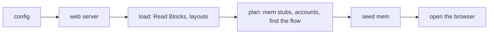
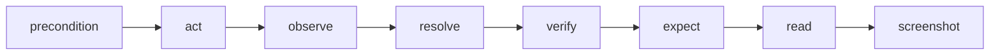

# How a run works

What happens, in order, from `waygraph run checkoutFlow` to the last step. Knowing this tells you *when* your code runs:
when a file is imported, when a Block's functions are called, and why some things are written as `() => Block`.

## 1. Loading (once per run)

1. **The config** (`config/waygraph.config.ts`) is read first, and what it resolves to becomes environment (`baseUrl`,
   `device`, the demo's settings). Flags beat it.
2. **The web server** the config names starts, if any.
3. **Loading.** `waygraph` imports, by scanning the project: Read Blocks, layouts (`_layout.block.ts`, which works out
   which pages each covers), then, while planning, mem stubs (on the keys, `*.mem-keys.ts`) and accounts (`src/accounts/`). Nothing
   imports these for their side effect: they register themselves when imported, and waygraph imports them.
4. **Planning** finds the flow (an export of a `*.flow.ts`, a file, or a chain `a then b`), turns it into steps, and
   seeds mem from `--data`, mem stubs or a replay.
5. **The browser opens** (your config's device, extensions, video), then the first step.

**Import time vs run time.** A file's top level runs *once, when it's imported*: `definePageBlock(...)`,
`defineMethodBlock(...)`, `engine.map()...` all run then, to *build* values. Their `act`, `verify`, `read` and `call`
functions run later, during steps. So a flow's chain is built (and type-checked, and its Blocks' kinds checked) at
import, before any browser exists.

## 2. A step

Each step of a flow plays the same sequence:

| Phase | Is | Runs |
|---|---|---|
| **precondition** | is the page ready for this Block | before `act`, retried briefly |
| **act** | the action: click, fill, goto, an API call | once |
| **observe** | reads from the page what `resolve` needs | after `act` |
| **resolve** | picks the Checkpoint the step landed on (pure) | after `observe` |
| **verify** | the Block's own checks: *did I arrive, did my action take effect* | retried until they hold (5 s) |
| **expect** | what the scenario expects (Expect Blocks, `Key.is`): read-only, all at once | after verify; `--no-expect` skips |
| **read** | the page's Read Blocks read what it shows (into the run log, the demo, `Key.is`) | on the landing page |
| **screenshot** | the page's picture, when a Block asks (`screenshot: true`) | last |

A step's `stubBefore` / `stubAfter` (the demo's narration) wrap it in a demo and do nothing in a run.

## 3. Around the steps

- **Mem** is one object for the run: `requires` keys are checked *before* the browser opens (a missing one fails
  preflight, naming it), and a key a step sets is available to the next.
- **Accounts:** a flow `as` an account starts with a `sign-in-as-…` step: a kept session, or the account's sign-in flow.
- **Panes:** a pane opens the first time a step acts in it (and signs in); `.close(pane)` closes it; the rest close when the
  flow ends.
- **Cleanup** (`.finally(Block)`) runs after the steps, pass or fail.
- **The run log** gets an event at each of these points (`step:start`, `step:read`, `step:end`, `step:error`, …).

## 4. Which mode

| | Differences |
|---|---|
| `waygraph run` | plays steps; nothing around them |
| `waygraph demo` | the stepper (panel, narration, rings) around each step, and a lock on the page |
| `waygraph test --flows` | every flow as a Playwright test, in its own worker and browser; loading happens in each worker |
| Waygraph Studio | reads the manifest (a scan: *imports* every file, runs no step) and the run logs |

## Why `do` and `expects` are functions

A Page Block lists its Methods, and a Method's `verify` may check the page (`Page.read.x`). Two files that import each
other at the top level break (an import cycle: one sees `undefined` at import time). `do: () => ({ addToCart: AddToCart })`
and `expects: (page) => ({ ... })` are *only called when someone first uses them*, after every file has finished
importing, so the cycle never bites. A mistake inside shows up when it is first used, not at import.

Two things stay at the top level, because TypeScript needs them there: a Method's `verify` that reads the page is written
as a function (`verify: (): Trait[] => [Page.read.x.is(1)]`), which is called when the Method runs, and `read` is a
function the page calls when a step lands on it. Both are lazy for the same reason.

**Rule of thumb:** `do` and `expects` are functions of the page; everything else is a plain value.
