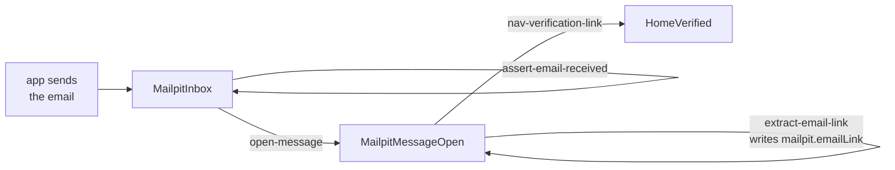

# Mail

A signup confirmation, a password reset, a magic link: the flow has to read an email. In waygraph that's more Blocks,
pointed at a mail catcher's own web page (Mailpit, MailHog, MailDev). No mail API client, no new engine code.



The scaffold ships it: `src/map/(external)/mailpit/`, the flow `src/flows/(user-stories)/email-verification.flow.ts`,
and `tests/mail-verify.spec.ts`, which starts a throwaway Mailpit in Docker.

## The Blocks

| Block | Kind | Does | Reads from mem |
|---|---|---|---|
| `nav-mailpit-inbox` | Nav | opens the inbox (`WAYGRAPH_MAIL_URL`, default `http://127.0.0.1:8025`) | - |
| `assert-email-received` | Assert | a message for the recipient arrived (opens nothing) | `mailpit.expectedRecipient` |
| `open-message` | Method | opens that recipient's newest message | `mailpit.expectedRecipient` |
| `assert-email-content` | Assert | the body says what it should | `mailpit.expectedEmailContent` |
| `extract-email-link` | Method | reads the matching link into mem | `mailpit.expectedLinkPattern` |
| `nav-verification-link` | Nav | back in the app, follows that link | `mailpit.emailLink` (written above) |

Reading the link and following it are two actions, so they are two Blocks. `nav-verification-link` has no
`requires`: an earlier step in the same flow writes the key, and `requires` is only for what comes from outside.

```ts
export const ExtractEmailLinkBlock = defineMethodBlock({
  name: "extract-email-link",
  from: MailpitMessageOpen,
  to: MailpitMessageOpen,
  requires: [MailpitKeys.expectedLinkPattern],
  instruction: {
    async act(page, _in, mem) {
      const pattern = mem.get(MailpitKeys.expectedLinkPattern);
      const link = page.frameLocator(MailpitSel.previewIframe).locator(`a[href*="${pattern}"]`).first();
      const href = await link.getAttribute("href");
      if (!href) throw new Error(`no link matching "${pattern}" in the message`);
      mem.set(MailpitKeys.emailLink, { url: href });
    },
  },
});

export const NavVerificationLinkBlock = defineNavBlock({
  name: "nav-verification-link",
  checkpoint: HomeVerified,
  url: (mem) => mem.get(MailpitKeys.emailLink).url,
  verify: [Trait.visible(DemoSel.verifiedBanner)],
});
```

## One set of Blocks, every email

The Blocks don't know which email they're reading; mem tells them. Signup and password reset use the same flow:

```ts
mem.set(MailpitKeys.expectedRecipient, { email: "new-user@example.com" });
mem.set(MailpitKeys.expectedLinkPattern, "verified=1");
mem.set(MailpitKeys.expectedEmailContent, "Please confirm your email address");
await emailVerificationFlow.run(context, mem);

mem.set(MailpitKeys.expectedRecipient, { email: "reset-user@example.com" });
mem.set(MailpitKeys.expectedEmailContent, "We received a request to reset your password");
await emailVerificationFlow.run(context, mem);
```

So name a Block for what it does (`extract-email-link`), not for one email (`extract-verification-link`).

## Parallel tests, one inbox

Workers sharing an inbox must not open the same message. `open-message` claims each one first:

```ts
for (const row of await page.locator(MailpitSel.messageRow, { hasText: email }).all()) {
  if (!(await claimOnce(`mailpit:${await row.getAttribute("href")}`))) continue;   // another worker has it
  await row.click();
  return;
}
```

`claimOnce(name)` is true for the first caller on the machine (any process) and false after, for 30 minutes
(`{ ttlMs }` changes that).

## Keep it in its own folder

The mail catcher is another site, so it lives under `(external)/` with its own Checkpoints (`_states.ts`) and keys
(`_keys.ts`), importing nothing from the app. That also makes it a [map package](../reference/map#map-packages) you can
publish and reuse. In `waygraph auto`, a URL Nav like `nav-mailpit-inbox` is offered only as "Start here", so it
doesn't crowd every page's menu.
