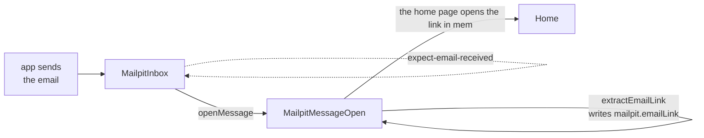

# Mail

A signup confirmation, a password reset, a magic link: the flow has to read an email. In waygraph that's more Blocks,
pointed at a mail catcher's own web page (Mailpit, MailHog, MailDev). No mail API client, no new engine code.



The scaffold ships it: `src/map/(external)/mailpit/`, the flow `src/flows/(user-stories)/email-verification.flow.ts`,
and `tests/mail-verify.spec.ts`, which starts a throwaway Mailpit in Docker.

## The pages

| Page | Holds | Reads from mem |
|---|---|---|
| `page-mailpit-inbox` (`MailpitInbox`, opens `WAYGRAPH_MAIL_URL`, default `http://127.0.0.1:8025`) | `expects.emailReceived`: a message for the recipient arrived (opens nothing), and the Method `openMessage`: opens that recipient's newest message | `mailpit.expectedRecipient` |
| `page-mailpit-message` (`MailpitMessageOpen`, from the inbox) | `expects.emailContent`: the body says what it should, and the Method `extractEmailLink`: reads the matching link into mem | `mailpit.expectedEmailContent`, `mailpit.expectedLinkPattern` |
| `page-home` (the app) | its `url` is the link in mem when there is one: opening it is following the link, and `expects.verified` says the banner is up | `mailpit.emailLink` (written above) |

The message you open is a page of its own (`/view/<id>`), not a state of the inbox, so what you can do and expect there lives
on it. Following the link is not a Block either: the home page's `url` is a function of mem, so the same page opens the
verification link when an earlier step wrote it, and `requires` stays for what comes from outside.

```ts
export const extractEmailLink = (self: PageHandle<"MailpitMessageOpen">) =>
  self.method({
    name: "extract-email-link",
    requires: [MailpitKeys.expectedLinkPattern],
    async act(page, _in, mem) {
      const pattern = mem.get(MailpitKeys.expectedLinkPattern);
      const link = page.frameLocator(MailpitSel.previewIframe).locator(`a[href*="${pattern}"]`).first();
      const href = await link.getAttribute("href");
      if (!href) throw new Error(`no link matching "${pattern}" in the message`);
      mem.set(MailpitKeys.emailLink, { url: href });
    },
  });

// the home page
url: (mem) => (mem.has(MailpitKeys.emailLink) ? mem.get(MailpitKeys.emailLink).url : HOME_URL),
```

## One set of Blocks, every email

The Blocks don't know which email they're reading; mem tells them. Signup and password reset use the same flow:

```ts
mem.set(MailpitKeys.expectedRecipient, { email: "new-user@example.com" });
mem.set(MailpitKeys.expectedLinkPattern, "verified=1");
mem.set(MailpitKeys.expectedEmailContent, "Please confirm your email address");
await emailVerificationFlow.run(context, mem);

mem.set(MailpitKeys.expectedRecipient, { email: "reset-user@example.com" });
mem.set(MailpitKeys.expectedEmailContent, "We received a request to reset your password");
await emailVerificationFlow.run(context, mem);
```

So name a Block for what it does (`extract-email-link`), not for one email (`extract-verification-link`).

## Parallel tests, one inbox

Workers sharing an inbox must not open the same message. `open-message` claims each one first:

```ts
for (const row of await page.locator(MailpitSel.messageRow, { hasText: email }).all()) {
  if (!(await claimOnce(`mailpit:${await row.getAttribute("href")}`))) continue;   // another worker has it
  await row.click();
  return;
}
```

`claimOnce(name)` is true for the first caller on the machine (any process) and false after, for 30 minutes
(`{ ttlMs }` changes that).

## Keep it in its own folder

The mail catcher is another site, so it lives under `(external)/` with its own pages and keys (`_keys.ts`)
(`_keys.ts`), importing nothing from the app. That also makes it a [map package](../reference/map#map-packages) you can
publish and reuse. In `waygraph auto`, a page with a `url` like `page-mailpit-inbox` is offered only as "Start here", so it
doesn't crowd every page's menu.
