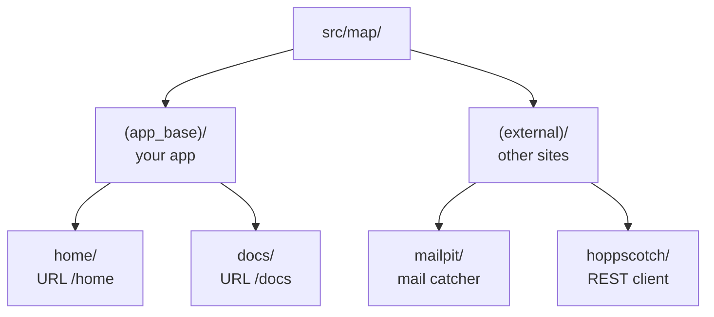

# Your project

`npx waygraph init my-app` makes a small project that works offline: `npm test` passes as soon as it is installed.
This page shows where each file goes and why.

## Folders mirror your app's URLs

Under `src/map/`, there is one folder per page, and the folder path is the page's URL. `waygraph map` fails when a
folder stops matching its real URL, so the tree can't drift away from the app.



`(group)` folders only organise things and are never part of a URL, the same as Next.js route groups.

## One page folder

Every page folder uses the same file names, so you (or an agent) always know where to look:

| File | Holds | Made with |
|---|---|---|
| `_nav.block.ts` | how to get to this page | `defineNavBlock` |
| `_page.block.ts` | "you have arrived", and what you can do here | `definePageBlock` |
| `_sel.ts` | every selector this page uses | a plain object |
| `_read.block.ts` | what the page shows, as data | `defineReadBlock` |
| `_reads.ts` | the namespace that data is typed by | `reads("home")<{…}>()` |
| `_methods/` | one action per file: fill, click, submit | `defineMethodBlock`, `defineEffectBlock`, `defineAssertBlock` |

A leading `_` means "this page's own machinery". A folder name without one is a child page with its own URL segment.

## The whole tree

```sh
my-app/
├── config/waygraph.config.ts     # baseUrl, webServer, extensions; exports `engine`
├── src/
│   ├── map/                      # pages (above)
│   ├── states/                   # Checkpoints (*.states.ts), mem keys (*.mem-keys.ts), mem stubs (*.mem-stubs.ts)
│   └── flows/                    # use cases, one file per scenario
├── tests/                        # Playwright specs, if you want any besides the flows
└── .agents/skills/               # how-to for coding agents
```

There is no `playwright.config.ts`: `waygraph test` builds the Playwright config from `config/waygraph.config.ts`
(see [Config](../reference/config)).

## Flows are use cases

`src/flows/` follows the pages too, but it holds the *stories*, not the parts:

| Path | Holds | Export |
|---|---|---|
| `flows/auth/login/success.flow.ts` | one page, one outcome | `loginSuccessFlow` |
| `flows/auth/login/wrong-password.flow.ts` | the same page, another outcome | `loginWrongPasswordFlow` |
| `flows/(user-stories)/checkout.flow.ts` | a story across pages | `checkoutFlow` |

A page's folder shows every way a user can go through that page.

## What to do where

| I want to... | Do this |
|---|---|
| add a page | copy a page folder, keep the `_` names, match the URL |
| add an action | one file in that page's `_methods/` |
| check a state (disabled button, error shown) | an Assert Block in `_methods/` ([Checks](./checks)) |
| say what a page shows | its `_read.block.ts` ([Read Blocks](./reads)) |
| string steps together | a file in `src/flows/` ([Flows](./flows)) |
| give a flow data | a mem key and a mem stub in `src/states/` ([Data](./data)) |
| keep folders honest | `waygraph map` |
| reuse a tool's pages in another project | `waygraph map pack <group>` ([The Map](../reference/map#map-packages)) |

## Pointing it at your real app

1. Set `baseUrl` in `config/waygraph.config.ts` (or `BASE_URL` in `.env`).
2. Change each `_nav.block.ts`'s `url` to the real path.
3. Rename `(app_base)/` and its folders to match your app's URLs.
4. Run `waygraph map`: it lists every folder that doesn't match.

## Keeping it up to date

```sh
npm install waygraph@latest
npx waygraph upgrade                                  # dry run: lists new and changed scaffold files
npx waygraph upgrade "src/map/(external)/hoppscotch" --apply
npx waygraph upgrade --skills                         # refresh .agents/skills
npx waygraph upgrade --codemod keys                   # rewrite code a release changed (see Deprecated)
```

`upgrade` copies only the paths you name, and replaces a file that differs only with `--overwrite`.

## A freeform layout

A small project can skip `src/map/`: any `*.block.ts` anywhere under `src/` is loaded. The
[Sauce Demo example](../saucedemo/) uses `src/blocks/saucedemo-web/<page>/` like that. Moving to the Map later only
moves files: [migrating](../reference/map#migrating-from-freeform-router-to-waygraph-map).
