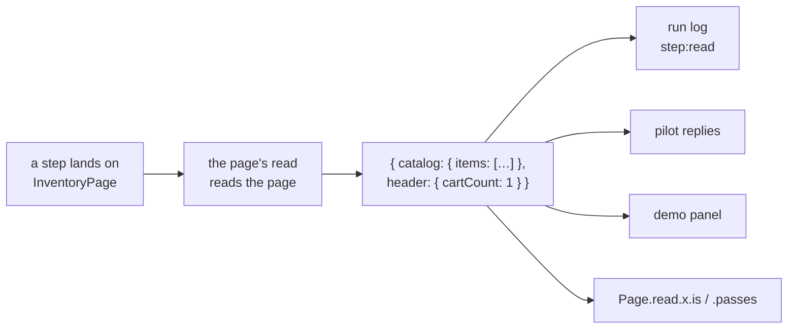

# What a page shows: `read`

A page lists what you can **do** on it (`do`) and what it **shows** (`read`): a typed object of what the page shows. An
agent in a session gets it as JSON after every step, without parsing the DOM; a test gets it as typed values.



Every page should have one: `waygraph check` lists the pages with no `read`.

## Write it on the page

`read` is a function of the run's context that returns a reader per field. The fields' types come from the readers, so
nothing is declared twice, and the page's keys exist as soon as it does: `Inventory.read.items`, typed.

```ts
// src/blocks/saucedemo-web/inventory/inventory.page.block.ts
import { definePageBlock } from "waygraph";

export const Inventory = definePageBlock({
  name: "page-inventory",
  checkpoint: InventoryPage,
  url: "/inventory.html",
  read: (ctx) => ({
    items: ctx.page.list(InventorySel.card, (row) => ({
      name: row.text(InventorySel.name),
      price: row.number(".inventory_item_price"),
      inCart: row.visible(InventorySel.removeBtnPrefix),
    })),
    sort: ctx.page.value(".product_sort_container"),
  }),
  do: () => ({ addToCart: AddToCart, removeFromCart: RemoveFromCart }),
});

Inventory.read.items;   // a ReadKey of { name: string; price: number; inCart: boolean }[], named "inventoryPage.items"
```

- **The name of what it reads** is the page's Checkpoint, lower-cased first (`inventoryPage.items` in the run log and
  `pilot read`). `readAs: "catalog"` names it otherwise: the name a project's recorded runs already use.
- **Nested objects:** return an object of readers (`author: { name: ctx.page.text(".a"), url: ctx.page.attr(".a", "href") }`).
  `Page.read.author` is the whole object and `Page.read.author.name` one field of it.
- **What every page of a layout shows** (a header, the signed-in user) is the layout's `read`, `Layout.read.cartCount`
  ([Layouts](./layouts)).
- **Mem:** `ctx.mem.get(key)` reads what the flow carried; a read that needs a key not set is skipped, and the reply says
  why.

A page's read never acts, navigates or appears in a flow. `run`, `demo`, `test` and the live sessions load it with the
page. After a step lands on a Checkpoint, its page's read (and its layout's) is read and merged. Two reads of the same
key on one page fail with `WG_READ_DUPLICATE`.

::: details Coming from Read Blocks?
A page's reads used to live in a `defineReadBlock` file with a `reads("ns")<T>()` namespace beside it (deprecated now: the
same job in three files). `waygraph upgrade --codemod page-object` moves each into its page (see [Removed](/deprecated)).
:::

## Readers

| `ctx.page.` | Gives | When nothing matches |
|---|---|---|
| `text(sel)` | text of the first match | missing |
| `texts(sel)` | every match's text | `[]` |
| `number(sel)` | first number in the text: `"$1,299.00"` -> 1299, `"41 likes"` -> 41 | missing |
| `attr(sel, name)` | an attribute | missing |
| `value(sel)` | a form field's value | missing |
| `visible(sel)` | whether any match is visible | `false` |
| `count(sel)` | how many match | `0` |
| `list(rowSel, (row) => ({ ... }))` | one object per row; `row.text(".x")` reads inside the row, `row.text()` the row itself | `[]` |
| `table(sel, { field: "Header" })` | one object per row, each field the cell under that column header (`<th>` or `role=columnheader`) | missing |
| `fn(async (page, mem) => value)` | anything else | `null`/`undefined` is missing |

Top-level selectors are Playwright selectors; selectors inside a `list` row are CSS. A read never waits: it takes the
page as it is (verify Traits are what wait). Text is the element's `textContent` with whitespace collapsed, like
Playwright's `allTextContents`, so text hidden with CSS inside the element is included.

**Speed:** each field, list or table is one round trip to the page, however many rows it has. A 1,000 x 8 table is
one call, about 70-150 ms.

**Notes:** a table column that isn't there, or a grid that renders fewer rows than its `aria-rowcount`, is reported
in the read's notes (`3 of 2,400 rows rendered (scroll or page to read more)`). Scrolling or paging is an action, so it
belongs in a Method.

## In code: `ReadPage`

```ts
import { readCheckpoint } from "waygraph";

const { read } = await readCheckpoint(page, mem, "InventoryPage");
read.get(Menu.read.cartCount);   // number - throws WG_READ_MISSING (naming the key) when the page didn't show it
read.has(Inventory.read.sort);       // false when missing
read.missing;                 // ["header.title", ...]
read.toJSON();                // { catalog: { items: [...], sort: "az" }, header: { ... } }
```

## In a check: `Key.is` and `Key.passes`

A check in the page's own terms instead of selectors: it reads the key now, through the read that fills its
namespace. Retried like every Trait until the page settles; on failure it says what the page showed, and the demo rings
the element the value came from.

```ts
.method(InventoryPage.do.addAllToCart, {
  expect: [
    Inventory.read.items.passes((items) => items.length === 6, "6 products"),
    Menu.read.cartCount.is(6),                                           // equal (deep, for lists and objects)
    // the test also gets mem: what the page shows against what the flow did
    Inventory.read.items.passes((items, mem) => items.some((i) => i.inCart && i.name === mem.get(ShopKeys.selectedItem).name), "the selected item in the cart"),
  ],
})
```

They are Traits, so they also fit a Block's `verify` or an Expect Block's.

```text
add-all-to-cart: check "read(catalog.items)" didn't pass
  wanted  6 products
  saw     [{"name":"Sauce Labs Backpack",...}]
```

When the page doesn't show the key at all, the failure says what else its namespace showed: the error a form gave
instead of the confirmation it was meant to show.

```text
submit-magic-link: check "read(login.sent)" didn't pass
  wanted  the confirmation
  saw     no value for login.sent; the page shows login.emailError "Could not send the link. Try again in a moment."
```

## In a session: `read`, and every reply

```sh
waygraph pilot read <sessionId>                                   # the whole page
waygraph pilot read <sessionId> catalog.items                     # one part
waygraph pilot read <sessionId> catalog.items --where inCart=true # a list's rows where a field matches
waygraph pilot read <sessionId> catalog.items --rows 20:40        # rows 20 to 39
```

```json
{ "ok": true, "page": "InventoryPage", "url": "https://www.saucedemo.com/inventory.html",
  "read": { "catalog": { "items": [{ "name": "Sauce Labs Backpack", "price": 29.99, "inCart": true }, "..."], "sort": "az" },
            "header": { "title": "Products", "cartCount": 1 } },
  "missing": [], "notes": {}, "readBlocks": ["read-inventory", "read-header"], "skipped": [] }
```

`status`, `send` and `reach` replies carry `read` and `missing` for the page the step landed on, so an agent sees
the effect of what it just did (`cartCount: 1`, `inCart: true`) without another call. Lists in those replies are cut
to 20 items (`readNotes` says so); `read <path>` returns them all. On a page no Read Block covers, `read` is empty and
says to use `dom`.

## In every run, and in the manifest

After each step's verify, the run reads the page it landed on (once the page has stopped changing: a verify on the URL
can pass before a client-side route renders) and emits a `step:read` run event: `{ checkpoint, read, missing, notes,
readBlocks }`. So `waygraph run`, `traverse` and sessions all log what each node showed to `.waygraph/runs/*.jsonl`. A
Read Block that fails (two reading one key) is reported on the event and never fails the run.

`waygraph manifest` lists every page's read with the Checkpoint it reads and the shape of its fields, without running
anything:

```json
{ "name": "read-inventory", "from": ["InventoryPage"],
  "fields": { "catalog.items": [{ "name": "string", "price": "number", "inCart": "boolean" }], "catalog.sort": "string" } }
```

## In the demo

The panel after each step has a **The page shows** section: every value its page's read gave, one line each.

Mem keys are declared the same way, with `keys("checkout")<{ credentials: Creds; selectedItem: Item }>()`: mem is
what a flow is given, a read is what the page shows ([Data](./data)).
