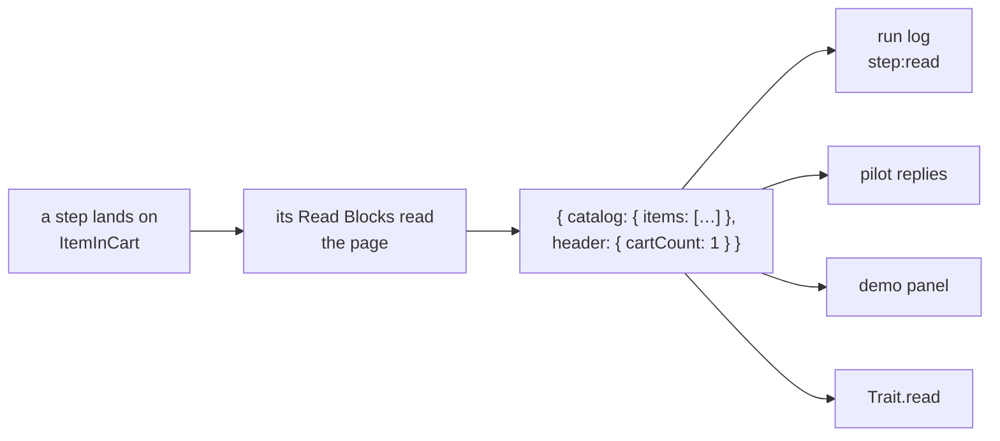

# Read Blocks

A page Block lists what you can **do** on a page (its methods). A **Read Block** says what you can **know** there:
a typed object of what the page shows. An agent in a session gets it as JSON after every step, without parsing the
DOM; a test gets it as typed values.



Every page should have one: `waygraph check` lists the pages no Read Block reads.

## Declare the keys: one namespace, one type

```ts
// src/states/checkout.reads.ts
import { reads } from "waygraph";

export const Catalog = reads("catalog")<{
  items: { name: string; price: number; inCart: boolean }[];
  sort: string;
}>();
export const Header = reads("header")<{ title: string; cartCount: number }>();
```

Property names become key paths: `Catalog.items` is a `ReadKey` named `catalog.items`. No `const` per key.

## Write the Read Block

It sits next to the page, shaped like a Method, with one instruction phase: `read`.

```ts
// src/blocks/saucedemo-web/inventory/inventory.read.block.ts  (in the Map layout: the page folder's _read.block.ts)
import { defineReadBlock } from "waygraph";

export const InventoryReadBlock = defineReadBlock({
  name: "read-inventory",
  description: "Every product, its price and whether it is in the cart; the sort order.",
  from: [LoggedIn, ItemInCart],
  instruction: {
    read: (ctx) =>
      Catalog({
        items: ctx.page.list(InventorySel.card, (row) => ({
          name: row.text(InventorySel.name),
          price: row.number(".inventory_item_price"),
          inCart: row.visible(InventorySel.removeBtnPrefix),
        })),
        sort: ctx.page.value(".product_sort_container"),
      }),
  },
});
```

- **`from`**: the Checkpoint(s) whose page this reads. Leave it out to read on every page (a header, the signed-in
  user).
- **Type-checked:** a reader of the wrong type doesn't compile (`price: row.text(...)` when `price` is a `number`).
  A page may read part of a namespace.
- **Several namespaces:** `read` can return an array (`[Catalog({...}), Header({...})]`).
- **Nested objects:** pass an object of readers (`author: { name: ctx.page.text(".a"), url: ctx.page.attr(".a", "href") }`).
- **`requires`:** a Read Block that needs Mem (`ctx.mem.get(...)`) declares it. Without it set, the Read Block is
  skipped and the reply says why.

A Read Block never acts, navigates or appears in a flow. After a step lands on a Checkpoint, every Read Block for it
(plus the every-page ones) is read and merged. Two Read Blocks reading the same key on one page fail with
`WG_READ_DUPLICATE`.

## Readers

| `ctx.page.` | Gives | When nothing matches |
|---|---|---|
| `text(sel)` | text of the first match | missing |
| `texts(sel)` | every match's text | `[]` |
| `number(sel)` | first number in the text: `"$1,299.00"` -> 1299, `"41 likes"` -> 41 | missing |
| `attr(sel, name)` | an attribute | missing |
| `value(sel)` | a form field's value | missing |
| `visible(sel)` | whether any match is visible | `false` |
| `count(sel)` | how many match | `0` |
| `list(rowSel, (row) => ({ ... }))` | one object per row; `row.text(".x")` reads inside the row, `row.text()` the row itself | `[]` |
| `table(sel, { field: "Header" })` | one object per row, each field the cell under that column header (`<th>` or `role=columnheader`) | missing |
| `fn(async (page, mem) => value)` | anything else | `null`/`undefined` is missing |

Top-level selectors are Playwright selectors; selectors inside a `list` row are CSS. A read never waits: it takes the
page as it is (verify Traits are what wait). Text is the element's `textContent` with whitespace collapsed, like
Playwright's `allTextContents`, so text hidden with CSS inside the element is included.

**Speed:** each field, list or table is one round trip to the page, however many rows it has. A 1,000 x 8 table is
one call, about 70-150 ms.

**Notes:** a table column that isn't there, or a grid that renders fewer rows than its `aria-rowcount`, is reported
in the read's notes (`3 of 2,400 rows rendered (scroll or page to read more)`). Scrolling or paging is an action, so it
belongs in a Method.

## In code: `ReadPage`

```ts
import { readCheckpoint } from "waygraph";

const { read } = await readCheckpoint(page, mem, "ItemInCart");
read.get(Header.cartCount);   // number - throws WG_READ_MISSING (naming the key) when the page didn't show it
read.has(Catalog.sort);       // false when missing
read.missing;                 // ["header.title", ...]
read.toJSON();                // { catalog: { items: [...], sort: "az" }, header: { ... } }
```

## In a check: `Trait.read`

A verify check in the page's own terms instead of selectors: it reads the key now, through the Read Blocks that fill
its namespace, and passes when `test` does. Retried like every Trait until the page settles; on failure it says what
the page showed.

```ts
verify: [
  Trait.read(Catalog.items, (items) => items.length === 6, "6 products"),
  Trait.read(Header.cartCount, (n) => n === 1),
],
```

```text
trait "read(catalog.items)" failed after "add-all-to-cart": wanted 6 products; saw [{"name":"Sauce Labs Backpack",...}]
```

## In a session: `read`, and every reply

```sh
waygraph pilot read <sessionId>                                   # the whole page
waygraph pilot read <sessionId> catalog.items                     # one part
waygraph pilot read <sessionId> catalog.items --where inCart=true # a list's rows where a field matches
waygraph pilot read <sessionId> catalog.items --rows 20:40        # rows 20 to 39
```

```json
{ "ok": true, "page": "ItemInCart", "url": "https://www.saucedemo.com/inventory.html",
  "read": { "catalog": { "items": [{ "name": "Sauce Labs Backpack", "price": 29.99, "inCart": true }, "..."], "sort": "az" },
            "header": { "title": "Products", "cartCount": 1 } },
  "missing": [], "notes": {}, "readBlocks": ["read-inventory", "read-header"], "skipped": [] }
```

`status`, `send` and `reach` replies carry `read` and `missing` for the page the step landed on, so an agent sees
the effect of what it just did (`cartCount: 1`, `inCart: true`) without another call. Lists in those replies are cut
to 20 items (`readNotes` says so); `read <path>` returns them all. On a page no Read Block covers, `read` is empty and
says to use `dom`.

## In every run, and in the manifest

After each step's verify, the run reads the page it landed on (once the page has stopped changing: a verify on the URL
can pass before a client-side route renders) and emits a `step:read` run event: `{ checkpoint, read, missing, notes,
readBlocks }`. So `waygraph run`, `traverse` and sessions all log what each node showed to `.waygraph/runs/*.jsonl`. A
Read Block that fails (two reading one key) is reported on the event and never fails the run.

`waygraph manifest` lists every Read Block with the Checkpoints it reads and the shape of its fields, without running
anything:

```json
{ "name": "read-inventory", "from": ["LoggedIn", "ItemInCart"],
  "fields": { "catalog.items": [{ "name": "string", "price": "number", "inCart": "boolean" }], "catalog.sort": "string" } }
```

## In the demo

The panel after each step has a **The page shows** section: every value its Read Blocks read, one line each.

Mem keys are declared the same way, with `keys("checkout")<{ credentials: Creds; selectedItem: Item }>()`: mem is
what a flow is given, a read is what the page shows ([Data](./data)).
