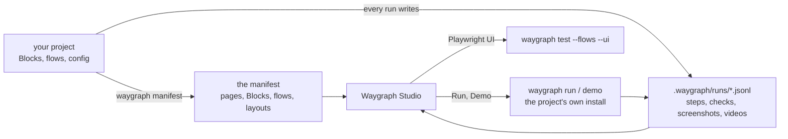

# Waygraph Studio

The project in the browser, drawn by hand: its pages and the Blocks between them, its flows step by step with what
each step expects, its runs, and a button to play any flow.


> [!WARNING]
> **Beta.** What its pages show and where things sit can change from one version to the next. It only reads your
> project and plays its flows; it never changes your files.

```sh
npx waygraph studio            # in the project, or any folder inside it
npx waygraph studio ../shop    # another project
```

It comes with waygraph (0.16.13 and later) and needs Node 24 or newer, like the rest of waygraph: nothing else to
install. In a project, `npx waygraph studio` runs the project's own waygraph; on an older one, update it first
(`npm install waygraph@latest`). It prints the address (`http://localhost:9294`, or the next free port; `--port N`
picks one). Ctrl-C stops it, and a flow it's still playing, with its browser.

The project is the folder you name, or the one the current folder is in: the nearest folder, here or above, with a
`waygraph.config.*` (in it or in `config/`) or a `package.json` that depends on waygraph.

## How it works



- **It reads; it never writes.** The map and the flows come from [`waygraph manifest`](../reference/run-log#the-manifest),
  read through the project's own install, and the runs from `.waygraph/runs/`. Nothing it shows is stored anywhere else.
- **It plays with your waygraph.** **Run** and **Demo** start the project's own `waygraph run` / `waygraph demo`, the
  same as you would from a terminal, so a run from the UI writes the same run log as any other.
- **It stays quick.** A manifest older than 30 seconds is still shown at once while a new one is read (the refresh
  button in the sidebar waits for the new one), and a page loads when you point at its link.

## The map

The project as a site map: each site at the top (the base url's host, and every other site a page's address names: a
payment provider, a mail catcher), its pages below by their addresses, one level per part of the address. A part no
page has is a folder (`auth/`, `platform/`, then `plant/`, so `/platform/plant/lines` sits three levels in).

- **Dashed lines** hang each page from its site, labelled with what opens it by address (a Page Block's `url`, or a Nav).
- **Arrows** are the moves between pages, labelled with the Blocks that make them: a badge per Block, with its whole
  name, in its kind's colour and with its icon (Nav blue, Method grey, API green). Labels meeting at one page stack, and
  the map makes room for them: a label never covers a box.
- **A page's box** has its newest [screenshot](./blocks#screenshots) (when a Block took one), its address, how much you
  can do there, how many flows pass through it and how many failed their newest run, and what it shows: the fields
  its [read](./reads) gives, by namespace, the yes/no ones highlighted as the states the page can be in
  (`login.linkSent`), which flows check with `Key.is` instead of a Checkpoint of their own.
- **A [shell](./layouts)** (a page that covers pages: a menu, a sidebar) is a dashed halo behind each page it covers, with its tag above the
  first: its links as chips (click one to go to its page) and its interrupts as badges. Its links aren't drawn from every
  page, so there is no web of lines; each page it covers carries its name.

A page's address comes from its own `url` (or its folder, or a Nav) that opens it (a url built from mem shows as a pattern: `/requests/:id`) and from
the `Trait.url` its Blocks verify on arrival. A page with no address of its own sits under the page whose move reaches
it. Pages in a row follow the order your flows visit them.

**Find** (the button at the top, or `/`, or Ctrl/Cmd-K) finds a page, a flow or a Block by name: type a few letters, Enter, and
the page or Block's panel opens (a flow opens its own page).

The **bottom bar** holds the key (the Block kinds), **Legend** (every shape, line and badge, and what's in a page's
box), the switch between left to right and top down (remembered), and the counts.


Beside the map, the site map as a folder tree: uncheck a site, a folder or a page to leave it off the map, or keep one
branch with **only** (say, just `platform/plant/equipment`); your browser remembers the choice for the project. The
tree minimizes to a **Pages** button, with how many pages the map shows.

### A page

Click a page for everything about it, most telling first:


1. Its screenshot, addresses, how its flows' newest runs went (failing, passing, not run), its layouts and who can open
   it (its Page Block's `for`).
2. Each move and expectation has a dot: how it last went in the runs the app has read (green passed, red failed, grey not
   run). A move with params says so: a flow gives it values, so the auto and Pilot menus don't list it.
3. **Shows (read)**: its `read` fields, the yes/no states first, and the query params it keeps in its address (`?tab`).
   **Arrives when**: the checks that prove the browser is on this page.
3. **Opens from**, **Do**, **Leads to**: its Blocks (a Method written in the page shows by its key). Open one for its checks, the selectors it reads and its code; the
   arrows in the panel's corner widen it to read code.
4. **Expected here**: its Expect Blocks, and what Blocks promise on arrival.
5. **Selectors** its Blocks read, then **Network**: the calls the flows' newest runs made on arrival (per route: how many, how long, the status), with findings on them (the same GET twice, one route asked with many ids, slow, large, failed; the same as `waygraph check --network`), and **Flows** last: each one that lands there, may land there (a step with several
   outcomes that ends the flow) or does something there, failing first.

### A shell

Click a shell's name for its links (where each leads, its selector, who sees it), its actions, what it shows, what it handles when it
shows up (its [interrupts](./layouts#interrupts-what-appears-and-gets-in-the-way)) and the pages it covers; click a page there to go to it.


### As one account

When the project has [accounts](./flows#accounts), the bottom bar shows the map as one of them (**As planner**): the
pages it can't open and the Blocks it isn't given (`for`) are left out, and it says how many. The address keeps the
choice (`?as=planner`), so a view can be shared.

### In the dark

The map, and every page, follow your system's light or dark theme.


## Flows

Every flow by its folder, failing first, with its steps, expectations and newest run; filter by failing, passing or not
run, or find one by a step.


Open one for its steps on a canvas, each with what it [expects](./checks#expect-what-the-scenario-expects), and its
recent runs (a download for each video). Its shapes follow flowchart's: a step that goes to a page (a Nav or Page step)
is a terminator, an API call an input / output, a fast-forward a predefined process, any other step a process.


A flow with [panes](./split-view), and its runs, are lanes: one per pane, each step at its place in the flow so the
arrows read in order across them; a compared run (`--compare`) marks each step where the two sides differed.

### Playing a flow

- **Run** plays it in the background (`waygraph run`); **Demo** opens a browser with the step panel (`waygraph demo`);
  **Playwright UI** opens it as a Playwright test on the Playwright page.
- **verify only** skips the expectations (`--no-expect`). **Record video** and **Show the browser** (off: headless) say
  how it plays, kept in your browser.
- The run's page follows it step by step; a step that fails opens as it happens. Every page shows what's playing, with
  **Stop**, which ends the flow and its browser. One flow plays at a time.

## Runs

Every run from the [run log](../reference/run-log), newest first, and each run step by step: whether it passed, how long
it took, the address it ended on, its screenshot when one was taken, and what the flow expected after it.


A failed step opens with what its check wanted and what it saw, and the mem the run was given:


- **Run again** or **Demo again** plays a run of one flow with the mem it was seeded with (`--replay`; what the run made
  new, a name from `unique`, is made new again).
- A run recorded with `--video` has **Video**: it plays in the page, and **Download video** saves it. A run with a
  Playwright trace has **Trace** to download (open it with `npx playwright show-trace`).
- A run with no flow named (a test calling `flow.run`) counts for the flow whose steps it played.

## Blocks

Every Block by the folder it lives in, with its kind, route (`from` → `to`), what it requires and how its newest runs
went.


Open one for what it checks (before acting and on arrival, and what it promises wherever it's used), the selector
entries it reads, its code (the lines that define it), the flows that use it, and from the newest runs how often it ran
and failed, how long it takes, and what it did to the address: **navigates** (its step ended on another path: a submit
that redirects, a click a single-page app routes) or **changes the address** (it stayed on its page but changed the
query or hash: a tab or a filter kept in the url). The tabs beside it list the page's read (each field and its type),
the selectors (every entry of the selector files, with the Blocks that read each) and the mem keys (who requires each,
and the value the newest run used). Checks, selectors and code need waygraph 0.16.19 or later in the project.

## Project

The project's waygraph commands as buttons, run with its own waygraph from its folder, one at a time, with their
output: check, validate, typecheck, map, graph, list, nav, manifest, test, test --flows, upgrade, install. The ones
that change files (`upgrade --skills`, the codemods) ask first; **Stop** ends one and what it started. Below, its
[config](../reference/config): what it resolves to (after `.env`), or the file as written.


## Playwright

Playwright's UI mode over your flows (`waygraph test --flows --ui`), inside the app: **Open Playwright UI** starts it,
and every flow is a test you can run, watch and step through (its trace, actions and page snapshots). **Stop** ends it
and its browsers. On a flow, **Playwright UI** opens it with only that flow (**Show all flows** goes back to every one).

## Settings

The gear at the bottom of the sidebar. Kept in your browser.

| Setting | Default | Does |
|---|---|---|
| Sidebar | every page | which pages the sidebar shows (a hidden one still opens by its address) |
| Demo: Auto-advance | on | a demo started here moves on from each step by itself (`--auto-next`); off, it waits for Next (`--no-auto-next`). The step panel's own switch still changes it while the demo plays |

## Versions

What it can show depends on the waygraph in the project: the site map and page screenshots need 0.16.16 or later (on
an older one the pages hang from where flows reach them), checks, selectors and code 0.16.19, the config 0.16.18, labels
0.16.20, layouts and accounts 0.16.21.

The screenshots on this page are made with `npm run docs:studio-shots` in the waygraph repo, from the
[Sauce Demo example](../saucedemo/).
