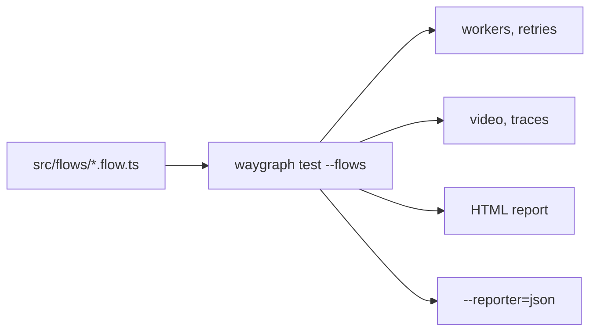

# Testing

Every flow is already a test. `waygraph test --flows` plays them all through Playwright's runner, with no spec files
to write.



## Commands

| Want | Command |
|---|---|
| every flow as a test | `npx waygraph test --flows` |
| some of them | `npx waygraph test --flows -g checkout` (matches file or export name) |
| a group of them | `npx waygraph test --flows --label auth` (the config's [labels](#labels); `--label auth,smoke` for either) |
| in parallel, with retries | `npx waygraph test --flows --workers 4 --retries 2` |
| your own specs too | `npx waygraph test` (anything after it goes to `playwright test`) |
| Playwright's UI mode | `npx waygraph test ui` |
| the last report | `npx waygraph test report` |
| one trace | `npx waygraph test show-trace <trace.zip>` |
| another environment | `npx waygraph test --flows --env staging` (loads `.env.staging`) |

Traces are kept for failures and the HTML report is on by default. Settings come from `config/waygraph.config.ts`
(`playwright: { workers, timeout, use }`): [Config](../reference/config).

## Labels

A label groups flows, so a group runs on its own. The config names each label and the flows it covers, by a glob over
their files or by a flow's export name; a flow can have several:

```ts
// config/waygraph.config.ts
labels: {
  auth: ["src/flows/auth/**", "logoutFlow"],
  smoke: ["loginFlow", "checkoutFlow"],
},
```

```sh
npx waygraph test --flows --label auth   # the auth flows
npx waygraph list --label auth           # which ones they are
```

Each flow's test is tagged with its labels (`@auth`), so Playwright's UI mode and its reports filter by them too, and
the manifest and Waygraph UI's Flows page show them. `waygraph check` warns about a label that covers no flow.

## Which flows run, and how

| A flow that... | Gets |
|---|---|
| has `map({ device })` | that device's size (the config's `device` sets every test's browser: size, phone layout, touch) |
| needs a key a mem stub supplies | the stub's value |
| needs a key nothing supplies | skipped, with the key named |
| starts on a page it doesn't open (an episode meant to follow another) | skipped, with the reason |
| has `map({ exclusive: true })` | runs alone, after all the others (it changes data the rest read); `--label`, `--grep` and `--grep-invert` pick among them too, without running the others first |
| has `map({ expectedFailure })` | passes when it fails |

## Access tests

When the project says who's given what (`for`, on [layouts](./layouts)' links, Methods and Page Blocks), `waygraph test
--flows` adds one test per account after the flows: `access › planner`, tagged `@access @planner` (so `--grep @access`
runs only them). Signed in as the account, it opens a page each layout covers, by its address, and checks that the
layout shows exactly the links the account is given: a link it's given that isn't showing fails it, and so does one it
isn't given that shows (a menu that hides its links is opened first). Then it opens each page the account isn't given
and expects it not to open. An account that can't sign in is skipped, saying why.

```
access as planner:
  sidebar › reports shows, and planner isn't given it (#reports): add planner to its for, or hide it
```

## The world a flow runs in

A flow can set its time zone and network, and gets them put back when it ends, pass or fail, so an outage test doesn't
leave the next flow offline:

```ts
engine.map({ timezone: "Asia/Tokyo" })                                       // the page's clock (Chromium)
engine.map({ network: { throttle: "slow-3g" } })                             // or "fast-3g", { latencyMs, downloadKbps, uploadKbps }
engine.map({ network: { throttle: "offline" } })                             // every browser
engine.map({ network: { faults: [{ url: "**/api/orders", status: 503 }] } }) // or abort: true, delayMs: 3000
```

A fault answers matching requests instead of the server (`status`, `body`), fails them (`abort`), or holds them first
(`delayMs`).

## Tests that share things

| Shared | Use |
|---|---|
| one mail inbox | `claimOnce(name)`: true for the first caller on the machine, false after, so two workers never open the same email ([Mail](./mail)) |
| data one test creates | `unique` in its mem stubs ([Data](./data#different-every-run-unique)), and a `.finally` cleanup |
| a signed-in user | `map({ as: Account })`: signs in once per worker ([Flows](./flows#accounts)) |

## In a spec of your own

```ts
import { test } from "@playwright/test";
import { MemPage } from "waygraph";
import { checkoutFlow } from "../src/flows/checkout/checkout.flow.js";
import { SaucedemoKeys } from "../src/states/checkout.mem-keys.js";

test("checkout", async ({ context }) => {
  const mem = new MemPage();
  mem.set(SaucedemoKeys.credentials, { username: "standard_user", password: "secret_sauce" });
  await checkoutFlow.run(context, mem);
});
```

## Beyond the flows you wrote

| Command | Does |
|---|---|
| `npx waygraph traverse --parallel 4 --min-edge-coverage 80%` | walks every edge of the Block graph, writes `.waygraph-traverse/coverage.json`, exits 2 below the gate |
| `npx waygraph run checkoutFlow --all-branches` | plays every `.branch()` path |
| `WAYGRAPH_JSON=1 npx waygraph run checkoutFlow` | one JSON report on stdout (steps, timings, a failure screenshot) |

## In CI

```yaml
- run: npm ci && npx waygraph install --with-deps   # what the config requires, with the browsers' system packages
- run: npx waygraph check         # warnings only
- run: npx waygraph map           # exits 1 when a folder doesn't match its URL
- run: npx waygraph test --flows --workers 4 --reporter=html,json
```

Every run also leaves `.waygraph/runs/<runId>.jsonl` (one event per line), worth keeping as an artifact: a failed
check's `wanted` / `saw` is on its `step:error`.
