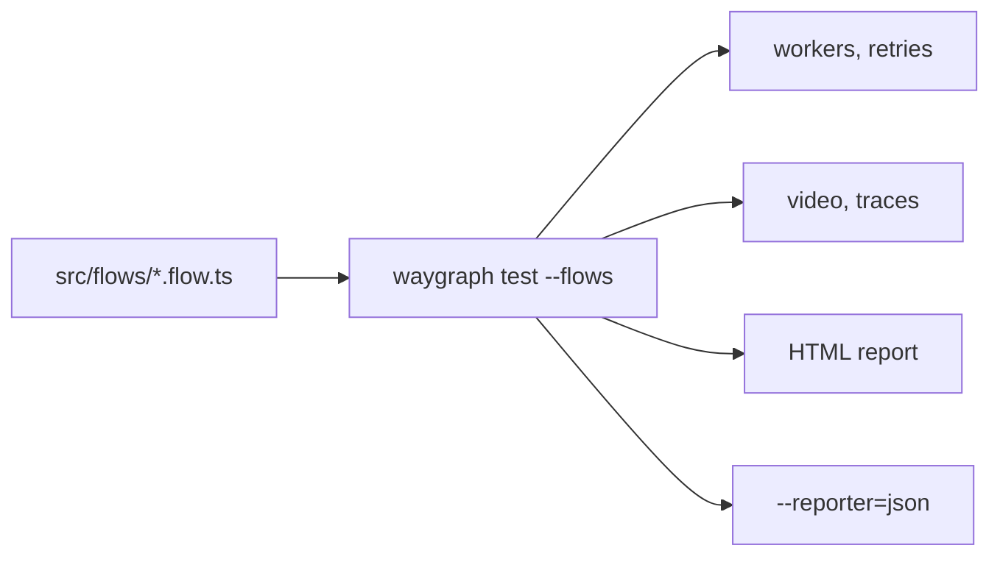

# Testing

Every flow is already a test. `waygraph test --flows` plays them all through Playwright's runner, with no spec files
to write.



## Commands

| Want | Command |
|---|---|
| every flow as a test | `npx waygraph test --flows` |
| some of them | `npx waygraph test --flows -g checkout` (matches file or export name) |
| in parallel, with retries | `npx waygraph test --flows --workers 4 --retries 2` |
| your own specs too | `npx waygraph test` (anything after it goes to `playwright test`) |
| Playwright's UI mode | `npx waygraph test ui` |
| the last report | `npx waygraph test report` |
| one trace | `npx waygraph test show-trace <trace.zip>` |
| another environment | `npx waygraph test --flows --env staging` (loads `.env.staging`) |

Traces are kept for failures and the HTML report is on by default. Settings come from `config/waygraph.config.ts`
(`playwright: { workers, timeout, use }`): [Config](../reference/config).

## Which flows run, and how

| A flow that... | Gets |
|---|---|
| has `map({ viewport })` | that browser size |
| needs a key a mem stub supplies | the stub's value |
| needs a key nothing supplies | skipped, with the key named |
| starts on a page it doesn't open (an episode meant to follow another) | skipped, with the reason |
| has `map({ exclusive: true })` | runs alone, after all the others (it changes data the rest read) |
| has `map({ expectedFailure })` | passes when it fails |

## The world a flow runs in

A flow can set its time zone and network, and gets them put back when it ends, pass or fail, so an outage test doesn't
leave the next flow offline:

```ts
engine.map({ timezone: "Asia/Tokyo" })                                       // the page's clock (Chromium)
engine.map({ network: { throttle: "slow-3g" } })                             // or "fast-3g", { latencyMs, downloadKbps, uploadKbps }
engine.map({ network: { throttle: "offline" } })                             // every browser
engine.map({ network: { faults: [{ url: "**/api/orders", status: 503 }] } }) // or abort: true, delayMs: 3000
```

A fault answers matching requests instead of the server (`status`, `body`), fails them (`abort`), or holds them first
(`delayMs`).

## Tests that share things

| Shared | Use |
|---|---|
| one mail inbox | `claimOnce(name)`: true for the first caller on the machine, false after, so two workers never open the same email ([Mail](./mail)) |
| data one test creates | `unique` in its mem stubs ([Data](./data#different-every-run-unique)), and a `.finally` cleanup |
| a signed-in user | `map({ as: Account })`: signs in once per worker ([Flows](./flows#accounts)) |

## In a spec of your own

```ts
import { test } from "@playwright/test";
import { MemPage } from "waygraph";
import { checkoutFlow } from "../src/flows/checkout.flow.js";
import { SaucedemoKeys } from "../src/states/checkout.mem-keys.js";

test("checkout", async ({ context }) => {
  const mem = new MemPage();
  mem.set(SaucedemoKeys.credentials, { username: "standard_user", password: "secret_sauce" });
  await checkoutFlow.run(context, mem);
});
```

## Beyond the flows you wrote

| Command | Does |
|---|---|
| `npx waygraph traverse --parallel 4 --min-edge-coverage 80%` | walks every edge of the Block graph, writes `.waygraph-traverse/coverage.json`, exits 2 below the gate |
| `npx waygraph run checkoutFlow --all-branches` | plays every `.branch()` path |
| `WAYGRAPH_JSON=1 npx waygraph run checkoutFlow` | one JSON report on stdout (steps, timings, a failure screenshot) |

## In CI

```yaml
- run: npm ci && npx playwright install --with-deps chromium
- run: npx waygraph check         # warnings only
- run: npx waygraph map           # exits 1 when a folder doesn't match its URL
- run: npx waygraph test --flows --workers 4 --reporter=html,json
```

Every run also leaves `.waygraph/runs/<runId>.jsonl` (one event per line), worth keeping as an artifact: a failed
check's `wanted` / `saw` is on its `step:error`.
