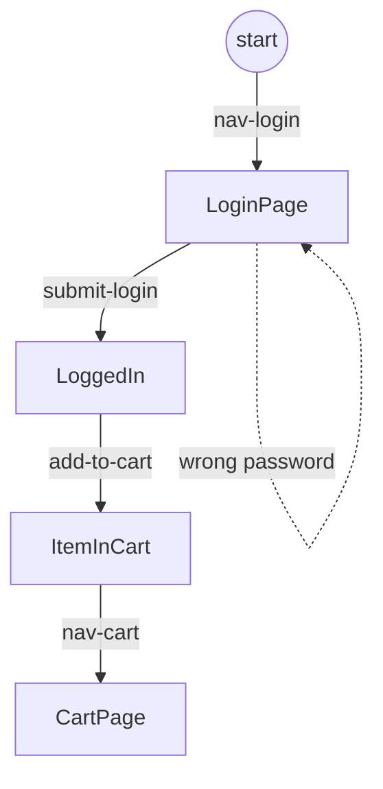
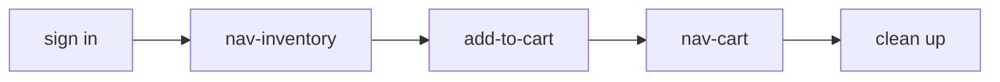
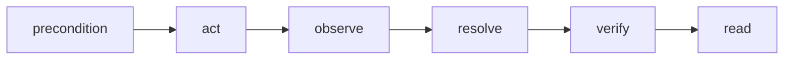
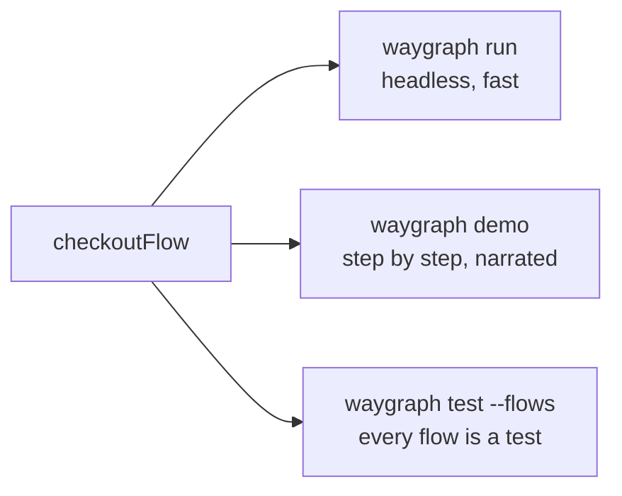

# How waygraph works

Waygraph is Playwright with a map. You describe your app once - its pages and what you can do on each - and every test
becomes a path through that map.

## Pages are Checkpoints, actions are Blocks

A **Checkpoint** is a place the app can be: the login page, the catalogue, a cart with an item in it.
A **Block** is one action that moves between Checkpoints: open a page, fill a field, submit a form.



Each arrow is one Block, in one file, doing one thing. A Block that can end in more than one place (the dotted arrow:
a wrong password keeps you on the login page) says so.

| Block | Does | Made with |
|---|---|---|
| Nav | goes to a page (a URL or a link) | `defineNavBlock` |
| Page | "you have arrived" - lists what you can do here | `definePageBlock` |
| Method | one action on the page: fill, click, submit | `defineMethodBlock` |
| Effect | an action on one row of many (add *this* item) | `defineEffectBlock` |
| Assert | a check that changes nothing | `defineAssertBlock` |
| API | an HTTP call, no page | `defineApiBlock` |
| Read | what the page **shows**, as data | `defineReadBlock` |

## A flow is a path

A **flow** picks a path through the map: which Blocks, in which order. TypeScript checks that each step starts where
the last one ended - you can't "teleport".



```ts
export const checkoutFlow = engine
  .map({ as: StandardUser })          // start signed in
  .gotoPage(NavInventoryBlock)
  .method(AddToCartBlock)
  .gotoPage(NavCartBlock)
  .finally(EmptyCartApiBlock)         // clean up, pass or fail
  .end();
```

## What happens in one step

The engine plays a flow one Block at a time. Every Block goes through the same steps:



| Phase | Asks |
|---|---|
| precondition | is the page ready for this step? |
| act | Playwright does the work: fill, click, request |
| observe | what happened? (only a Block that can land in more than one place) |
| resolve | which Checkpoint are we on now? |
| verify | do the Block's checks hold? Retried until the page settles |
| read | what does the page show now? (its Read Block) |

When a check fails it says what it **wanted**, what the page **showed**, and **where**:

```text
trait "text-equals(.toast, "Saved")" failed after "save-machine":
  wanted "Saved" in .toast; saw "Name is required" (on /equipment/new "Add equipment")
```

## Three ways to play a flow

The same flow, three ways. Nothing in the flow changes.



| Command | For | You get |
|---|---|---|
| `waygraph run checkoutFlow` | running it | pass / fail, a run log |
| `waygraph demo checkoutFlow` | showing it to a person | the overlay: rings, captions, a checklist, Next |
| `waygraph test --flows` | CI | every flow as a Playwright test: workers, retries, video, reports |

## What a run leaves behind

Every run writes `.waygraph/runs/<runId>.jsonl`, one event per line. Its path is printed at the end.

| Event | Says |
|---|---|
| `run:mem` | the data the run was seeded with (rerun with it: `--replay <runId>`) |
| `step:start` / `step:end` | each Block, where it started and landed, how long it took |
| `step:read` | what the page showed after the step (from its Read Block) |
| `step:error` | the failure, with what the check wanted and saw |

## Next

- [Quick start](./quickstart) - see it run in two minutes
- [Your project](./scaffold) - where each file goes
- [Read Blocks](./reference/reads) - make every page say what it shows
