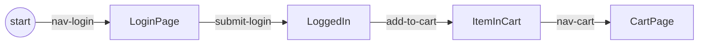

## The idea



| Word | Means |
|---|---|
| **Checkpoint** | a place the app can be: `LoginPage`, `ItemInCart` |
| **Block** | one action from one Checkpoint to another, with checks that prove it |
| **Flow** | Blocks in order. TypeScript checks each step starts where the last one ended |
| **Read Block** | what a page shows, as typed data |
| **Mem** | the data a run carries: credentials, the item being added |

## One flow, three ways to play it

| | Command | You get |
|---|---|---|
| run it | `npx waygraph run checkoutFlow` | pass / fail and a run log |
| show it | `npx waygraph demo checkoutFlow` | step by step, with rings and captions |
| test it | `npx waygraph test --flows` | every flow as a Playwright test |

## Try it

```sh
npx waygraph try demo        # watch a checkout on saucedemo.com, nothing written to your folder
npx waygraph init my-app     # a new project that passes offline
```

## Guides

| Start | Guides | Reference |
|---|---|---|
| [Quick start](/quickstart) | [Your project](/guides/project) · [Blocks](/guides/blocks) · [Flows](/guides/flows) | [CLI](/reference/cli) |
| [How it works](/how-it-works) | [Read Blocks](/guides/reads) · [Data](/guides/data) · [Checks](/guides/checks) | [Config](/reference/config) |
| [Sauce Demo](/saucedemo/) | [Demo](/guides/demo) · [Testing](/guides/testing) | [API](/api/) · [Environment](/env) |
| | [Agents](/guides/agents) · [Mail](/guides/mail) | [Deprecated](/deprecated) |
