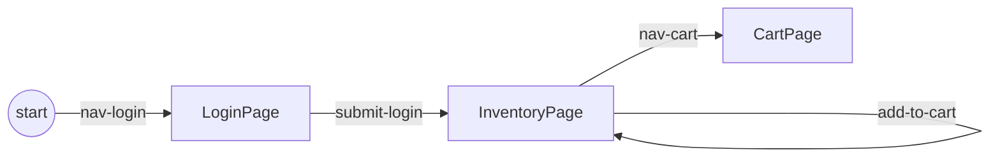

## The idea



| Word | Means |
|---|---|
| **Checkpoint** | a page the app can be on: `LoginPage`, `CartPage` |
| **Block** | one action from one Checkpoint to another, with checks that prove it |
| **Flow** | Blocks in order. TypeScript checks each step starts where the last one ended |
| **Read Block** | what a page shows, as typed data |
| **Mem** | the data a run carries: credentials, the item being added |

## One flow, three ways to play it

| | Command | You get |
|---|---|---|
| run it | `npx waygraph run checkoutFlow` | pass / fail and a run log |
| show it | `npx waygraph demo checkoutFlow` | step by step, with rings and captions |
| test it | `npx waygraph test --flows` | every flow as a Playwright test |

## See the whole project

`npx waygraph ui` draws the project by hand: every page by its address, the Blocks between them, each flow step by
step, and every run with what it checked. Play any flow from it. [Waygraph UI](/guides/ui)

[](/guides/ui)

| A run, step by step | A failure says why |
|---|---|
| [](/guides/ui#runs) | [](/guides/ui#runs) |

## One shape for every project

Every waygraph project puts the same things in the same places: folders that are the app's addresses, one folder per
page with the same file names, flows that are the tests. Each opinion says why, and what holds you to it.
[Your project](/guides/project)

## Try it

```sh
npx waygraph try demo        # watch a checkout on saucedemo.com, nothing written to your folder
npx waygraph init my-app     # a new project that passes offline
npx waygraph ui              # in a project: its map, flows and runs in the browser (beta)
```

## Guides

| Start | Guides | Reference |
|---|---|---|
| [Quick start](/quickstart) | [Your project](/guides/project) · [Layouts and access](/guides/layouts) · [Blocks](/guides/blocks) · [Flows](/guides/flows) | [CLI](/reference/cli) |
| [What Waygraph is](/doctrine) · [How it works](/how-it-works) | [Read Blocks](/guides/reads) · [Data](/guides/data) · [Checks](/guides/checks) | [Config](/reference/config) |
| [Sauce Demo](/saucedemo/) | [Demo](/guides/demo) · [Testing](/guides/testing) · [Waygraph UI](/guides/ui) (beta) | [API](/api/) · [Environment](/env) |
| | [Agents](/guides/agents) · [Mail](/guides/mail) | [Deprecated](/deprecated) |
