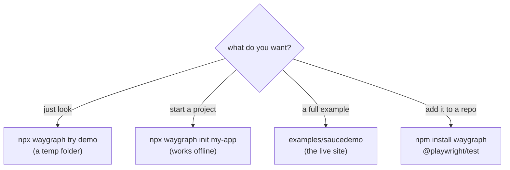
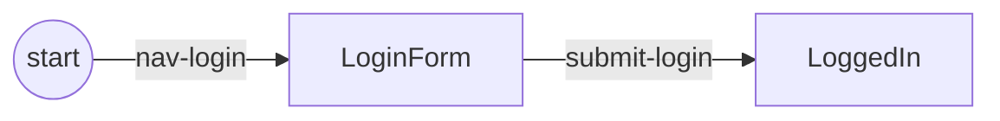

# Quick start

## Pick a way in



| Way in | Command | Writes to your folder? |
|---|---|---|
| watch a checkout on saucedemo.com, step by step | `npx waygraph try demo` | no |
| pick Blocks by hand on it | `npx waygraph try auto` (`try auto:cli` in the terminal) | no |
| a new project | `npx waygraph init my-app` | yes |
| the full Sauce Demo example | [below](#saucedemo) | yes |

Needs Node 22+ and `@playwright/test` 1.40+ (a peer dependency: you bring your own).

## A new project

```sh
npx waygraph init my-app
cd my-app
npm install
npx playwright install chromium
npm test                 # passes offline straight away
```

Then:

| Try | Command |
|---|---|
| watch a flow, step by step | `npm run demo` |
| the same, by itself | `npm run demo:auto-next` |
| play every flow as a test | `npx waygraph test --flows` |
| pick Blocks by hand | `npm run auto` (`npm run auto:cli` in the terminal) |
| list the flows | `npm run list` |
| lint Blocks and folders | `npm run check` |
| Playwright's UI | `npm run test:ui` |

What each file is for: [Your project](./guides/project).

## Your first Block and flow

```ts
import { Engine, MemPage, keys, checkpoint, defineNavBlock, defineMethodBlock, Trait } from "waygraph";

const LoginForm = checkpoint("LoginForm");
type LoginForm = typeof LoginForm;
const LoggedIn = checkpoint("LoggedIn");
type LoggedIn = typeof LoggedIn;

const LoginKeys = keys("login")<{ username: string }>();

const NavLogin = defineNavBlock({
  name: "nav-login",
  checkpoint: LoginForm,
  url: "https://example.com/login",
});

const SubmitLogin = defineMethodBlock({
  name: "submit-login",
  from: LoginForm,
  to: LoggedIn,
  requires: [LoginKeys.username],
  instruction: {
    async act(page, _input, mem) {
      await page.getByLabel("Username").fill(mem.get(LoginKeys.username));
      await page.getByRole("button", { name: "Sign in" }).click();
    },
    verify: [Trait.url({ pathname: "/dashboard" })],
  },
});

const mem = new MemPage();
mem.set(LoginKeys.username, "alice");

const flow = new Engine({ headless: true }).map().gotoPage(NavLogin).method(SubmitLogin).end();
await flow.run(mem);                    // inside a Playwright test: await flow.run(context, mem)
```



In a project the pieces go in their own files (`src/states/`, the page folder, `src/flows/`), and the flow imports
`engine` from `config/waygraph.config.ts`. [How it works](./how-it-works) explains each part.

## The Sauce Demo example {#saucedemo}

`examples/saucedemo` is a complete project against [saucedemo.com](https://www.saucedemo.com): live tests, demos,
accounts, Read Blocks. It uses the waygraph checkout it lives in, so build that first:

```sh
git clone https://github.com/deviate-dv8/waygraph.git
cd waygraph
npm install && npm run build
npx playwright install chromium
cd examples/saucedemo
npm install
npm test                 # 15 tests against the live site
npm run demo             # sign in, then shop
npm run auto             # pick Blocks by hand
```

Changed waygraph's source? `npm run build` at the root again; the example picks it up. A tour of its folders:
[Sauce Demo walkthrough](./saucedemo/).

## Next

- [How it works](./how-it-works): Checkpoints, Blocks, flows, one step's phases
- [Blocks](./guides/blocks) · [Flows](./guides/flows) · [Read Blocks](./guides/reads) · [Data](./guides/data)
- [Demo](./guides/demo): narrate a flow for people to watch
