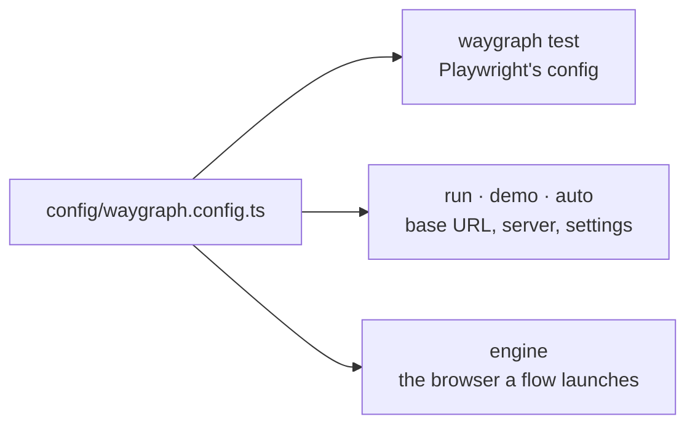

# Config

One file, `config/waygraph.config.ts` (the project root works too), holds everything a project needs to run. There is
no `playwright.config.ts`: `waygraph test` builds Playwright's config from this one.

```typescript
import { defineConfig, Engine } from "waygraph";

const config = defineConfig({
  baseUrl: "http://localhost:3130",
  testDir: "tests",                                  // default
  webServer: { command: "npm start", port: 3130 },   // started around test, run, demo and auto
  extensions: ["hoppscotch"],                        // browser extensions to load
  playwright: { workers: 1, timeout: 180_000, use: { video: "on" } },   // merged over waygraph's defaults
  run:  { slowMo: 0, video: { viewport: "1280x720" } },
  demo: { pace: "fast", typingMs: 20, autoNext: true, appearance: "dark" },
});
export default config;
export const engine = new Engine(config);           // every flow imports this
```



## The fields

| Field | Is |
|---|---|
| `baseUrl` | where relative URLs go (`WAYGRAPH_BASE_URL` overrides it) |
| `webServer` | `{ command, port }`, started before and stopped after |
| `extensions` | browser extensions ([below](#browser-extensions)) |
| `testDir` | where `waygraph test` looks for specs (default `tests`) |
| `playwright` | Playwright's own config, merged over the defaults: `fullyParallel`, `list` + `html` reporters, `trace: "retain-on-failure"`, `use.baseURL` from `baseUrl` |
| `slowMo`, `headed`, `video: { dir, viewport }` | run settings shared by `run` and `demo` |
| `run: { … }`, `demo: { … }` | the same per command, over the shared ones |
| `runLog` | `false` turns the run log off; a folder moves it ([Run log](./run-log)) |

Config values are defaults: a flag, a shell variable or a `.env` value beats them.

## Demo settings

| `demo.` | Does |
|---|---|
| `pace` | default pace for flows and steps that set none: `"fast"`, `"slow"`, `"blitz"`, or a multiplier |
| `speeds` | what the named paces mean, as multipliers of normal (`{ blitz: 0.05, fast: 0.33, slow: 2 }`) |
| `typingMs` | typing animation, ms per character (`0` types instantly) |
| `slowMo` | waygraph's pause after each action (in `run`, `slowMo` is Playwright's) |
| `autoNext`, `fast` | as the `--auto-next` / `--fast` flags |
| `appearance` | `"light"` or `"dark"` overlay, so recordings match whichever machine makes them |

## Environments and `.env`

`.env`, `.env.local`, `.env.<mode>` and `.env.<mode>.local` load from the project root, in that order, each over the
one before. The mode is `--env <mode>` (any command) or `WAYGRAPH_ENV`, else `NODE_ENV`, else `development`. A
variable already exported in the shell always wins over the files.

The config can be a function of them, so one project points at several environments:

```typescript
export default defineConfig(({ mode, env }) => ({
  baseUrl: env.BASE_URL,            // .env: http://localhost:3000 · .env.staging: https://staging.example.com
  extensions: mode === "staging" ? [] : ["hoppscotch"],
}));
```

```sh
npx waygraph test --flows --env staging
```

## Several configs

`config/waygraph.staging.config.ts` next to the default is picked with `--config staging` (any command, or
`WAYGRAPH_CONFIG`). The picked config replaces the default for everything. One can build on the other:
`defineConfig({ ...base, baseUrl: "https://staging.example.com" })`. A flow's `import { engine }` follows the picked
config too.

## Videos

`--video` saves to `<Downloads>/waygraph-videos/<project>` (`~/Downloads` on macOS and Windows, `XDG_DOWNLOAD_DIR` on
Linux). On CI, or without a Downloads folder, it's the project's `.waygraph-videos/`. `video.dir` in the config or
`WAYGRAPH_VIDEO_DIR` moves it; `--video <dir>` beats both. If the folder isn't writable (macOS can ask once for
permission), waygraph warns and saves in the project.

## The Engine

The config file exports `engine = new Engine(config)`, and every flow imports it. Options for the browser it launches
itself (`flow.run(mem)`, no context):

| Option | Does |
|---|---|
| `headless`, `browserName`, `slowMo` | how that browser launches; `flow.run(mem, { ...overrides })` changes them for one call |
| `browsers: { chromium, firefox, webkit }` | another launcher with Playwright's `.launch()` shape (a stealth-patched Chromium) |
| `layouts: [...]` | checks every step that lands on a matching Checkpoint runs ([Checks](../guides/checks#layouts-one-check-for-many-pages)) |

`flow.run(context, mem)` uses a context you already launched and ignores these. `spawnTab(entry, page, mem)` drives a
second tab, in the same context, through its own flow.

Flow settings (`map({ memStub, as, input, viewport, timezone, network, … })`) are on [Flows](../guides/flows#flow-settings).

## Browser dialogs

A `confirm()`, `alert()`, `prompt()` or `beforeunload` freezes the page until it is answered, so the answer is
armed around the Block's action rather than written into it: `withDialog(CancelBlock, { accept: true, into: LeaveWarning })`
(`accept: false` dismisses; `into` keeps the dialog's text in `mem` for an assert Block to check).

## Browser extensions

```typescript
export default defineConfig({
  extensions: ["hoppscotch", "./my-extension"],
});
```

Each entry is a known name (`hoppscotch`), a Chrome Web Store id, a path to an unpacked extension,
or `{ id, sha256 }` to pin the download. Store extensions are fetched on first use into
`$WAYGRAPH_CACHE_DIR` (default `~/.cache/waygraph/extensions`) and never replaced silently;
`waygraph extensions install [--update]` fetches or refreshes them ahead of time.
`WAYGRAPH_EXTENSIONS` (comma-separated unpacked directories) overrides the config.

Limits, because Chromium only loads extensions into a persistent profile:
- Chromium only, and Playwright's own build - `CHROME_PATH` is ignored while extensions are on.
- They load in the context waygraph launches (`run`, `demo`, `auto`, `pilot`, `Flow.run(mem)`),
  not in a Playwright test's `context` fixture, and not in `traverse` or `--all-branches`.
- A store extension keeps its store id (waygraph pins the `.crx`'s key in the manifest), so its requests carry a
  stable `Origin`, e.g. `chrome-extension://amknoiejhlmhancpahfcfcfhllgkpbld` for Hoppscotch. An API that checks
  `Origin` on writes (better-auth's `trustedOrigins`) can allow that one origin. Extensions cached by an older
  waygraph have a path-derived id; `waygraph extensions install --update` refetches them.
- An extension runs with its manifest permissions on every page of the run (Hoppscotch's asks for
  `<all_urls>` and cookies). Only list ones you trust, and pin `sha256` in shared configs.

## Testing a REST API through Hoppscotch

The scaffold's `(external)/hoppscotch` map drives Hoppscotch's REST client through its extension,
so requests skip CORS and can hit `localhost` APIs. Chain the blocks you need and set their `mem`
keys (`flows/hoppscotch-get`, `-post` and `-auth` are working examples):

| Block | Reads from `mem` |
|---|---|
| `set-method` | `RequestMethod` (`"POST"`, `"PUT"`, ...) |
| `set-url` | `RequestUrl` |
| `set-headers` | `RequestHeaders` (`{ name: value }`) |
| `set-query-params` | `RequestParams` (`{ name: value }`) |
| `set-bearer-token` | `RequestBearerToken` |
| `set-json-body` | `RequestBody` (JSON text) |
| `send-request` | - |
| `assert-status` | `ExpectedStatus` |
| `read-response-headers` | writes `ResponseHeaders` (lower-cased names) |
| `assert-response-header` | `ExpectedResponseHeader({ name, value })` |
| `read-response-body` | writes `ResponseBody` |
| `assert-response-body` | `ExpectedResponseText` (substring, whitespace ignored) |

Not covered yet: other auth types (Basic, API key, OAuth), form/multipart bodies, non-JSON content types.

## Updating an existing project

`npm install waygraph@latest` updates the framework, but the scaffold files copied at `init` stay as they were.
`waygraph upgrade [project]` compares the project with the scaffold shipped in the installed waygraph and lists
**new** files, **differing** files and a stale `waygraph` dependency. It is a dry run until you pass `--apply`.
Only the paths you name are copied (a real project usually deletes parts of the demo), and differing files are
replaced only with `--overwrite`; `--diff` prints what changed. For example:

```
waygraph upgrade "src/map/(external)/hoppscotch" src/flows --apply
```

`waygraph upgrade --skills` refreshes the agent skills in `.agents/skills` to the installed waygraph's (they are waygraph's own text, so it overwrites them). Shared files such as `src/states/*.ts` usually differ too, so review them with `--diff` and merge by hand.
