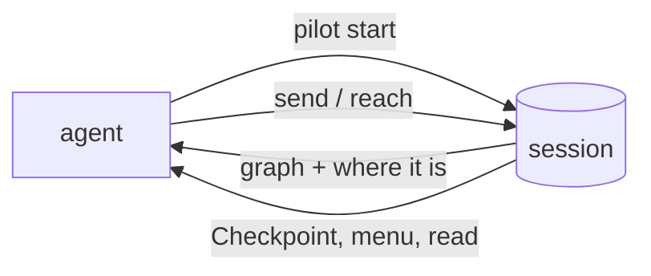

# Pilot

A session is a real browser that keeps running in the background, driven one JSON call at a time. It's how a coding
agent works on your app: it reads the graph, picks Blocks you've already checked, and sees where each one landed and
what the page shows. Pilot plans nothing itself; the agent does. Start with the guide: [Agents and exploring](../guides/agents).



## auto, browser, pilot

| Command | Is |
|---|---|
| `waygraph auto` | the interactive picker (a panel in the browser, or `--cli`) |
| `waygraph browser start` | a new session: visible by default (`--headless` for none), on `about:blank` (`--goto <url>`) |
| `waygraph pilot start` | `browser start`, plus the whole project graph and where it is, in one reply |

All three take the same session commands with the same id.

## Lifecycle

```bash
waygraph browser sessions [--json]       # what's live: check before opening another
waygraph pilot start                     # {"sessionId":"bb65d74c","socketPath":"...","headless":false,"graph":{...},"snapshot":{...}}
waygraph pilot attach <id>               # graph + snapshot for a session already running
waygraph browser attach <id>             # a terminal picker on it
waygraph browser stop <id>               # or --all
```

## Commands

| Command | Does |
|---|---|
| `status <id>` | the snapshot: where it is, the menu, what the page shows. No side effects |
| `send <id> "<pick>"` | runs one Block (menu index or name), answers with the new snapshot |
| `reach <id> <Checkpoint>` | finds the route and plays it, checking each step lands where its edge says |
| `read <id> [path] [--where f=v] [--rows a:b]` | what the page shows ([Read Blocks](../guides/reads)) |
| `dom <id> [--mode full] [--selector s] [--depth n]` | the accessibility tree (default, small), or a bounded DOM (`truncated: true` when cut) |
| `trace <id>` | the last 500 Blocks run: name, Checkpoint before and after, their narration |
| `console <id>` | console and network errors, and coverage gaps (below) |
| `storage <id>` | localStorage, sessionStorage, service workers |
| `highlight <id> "#x\|Label\|tone"` | paints rings on the page (or a JSON body) |
| `resync <id>` | re-detects where it is from the real page |
| `watch <id>` · `hello <id>` | the live feed · the protocol version and where it is |

**`reach` limits.** A route through a Nav that's open from anywhere, whose page needs setup first (fields filled before
a submit), can't be found safely: `reach` fails within a timeout instead of guessing.

**`resync`.** A session updates where it is only after its own actions. When a person clicks around in a visible
session, run `resync` before the next pick.

## Coverage gaps

A live session watches the page for things no Block covers yet, and says so once per element:

```text
[waygraph] unmapped nav link on this page: /settings - no NavBlock covers this URL; add defineNavBlock
[waygraph] unmapped button on this page: #save-draft - no Method/NavClick Block selector matches; consider defineMethodBlock or defineNavClickBlock
```

`console <id>` returns them. `waygraph check` can't find these: there's no Block to scan.

## On the page

A visible session shows a badge in the bottom-right corner (`Waygraph Pilot - session <id> - <Checkpoint>`); clicking
it lists the menu. Bottom-left toasts say what's running: `Running (Block): …` or `Running (no Block): …` for raw
`click` / `type` / `goto`. Both survive navigation.

## The session protocol (for clients such as Waygraph UI)

A live session (`browser start`, `pilot start`) is a process listening on a Unix socket. Requests and replies are
newline-delimited JSON; the types are exported: `SessionRequest`, `SessionResponse`, `SessionStreamMessage`,
`SESSION_OPS` (every op, once) and `SESSION_PROTOCOL_VERSION` (bumped when a shape changes; a new op or optional field
does not bump it).

| Op | Answers |
|---|---|
| `hello` | `{ protocol, waygraph, sessionId, here }`. Cheap, never waits behind a running step |
| `status`, `send`, `reach`, `resync`, raw actions | the snapshot: `here`, the menu, and `read` / `missing` where Read Blocks cover the page |
| `read`, `dom`, `trace`, `console`, `storage` | what the page / session shows, without changing anything |
| `subscribe` | keeps the socket open: one line per run event (`step:start`, `step:read`, `step:end`, ...) and one `{ type: "snapshot" }` after each change |

In code: `requestSession(projectDir, sessionId, { op: "status" })` for one request, and
`subscribeSession(projectDir, sessionId, (message) => ...)` for the feed (returns `close()`). From a terminal:
`waygraph pilot hello <id>` and `waygraph pilot watch <id>` (the feed, until Ctrl-C).

Requests run one at a time per session (a second waits for the first), except `hello` and `subscribe`.

## Blind pilot: no Blocks yet

A session works on a project with no Blocks at all (`here` stays `null`). Four commands let an agent build the library
as it goes:

```bash
waygraph auto click <id> "<selector>"
waygraph auto type <id> "<selector>" "<text>"
waygraph auto goto <id> "<url>"
waygraph auto reload <id>                # loads Block files just written, keeps the page and mem
```

`click` / `type` / `goto` re-detect where the session is and return a snapshot; a selector that matches nothing is a
failure naming it. waygraph writes no Blocks itself: the agent writes the `.block.ts`, `_sel.ts` and key files, then
`reload` and `send` the new Block.

| Gotcha | Means |
|---|---|
| `reload` did nothing | the new file probably throws on import: run `waygraph check` to see the error |
| a Block in no flow is in the menu | right: being an orphan only affects route finding |
