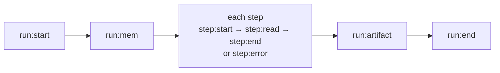

# Run log and manifest

Two JSON views of a project: the **run log** says what a run did; the **manifest** says what the project defines,
without running anything.

## The run log

Every `run`, `demo` and `test` writes `.waygraph/runs/<runId>.jsonl`, one event per line, and prints
`waygraph: run log <file>` when it ends. `runLog: false` in the config turns it off; `runLog: "<folder>"` moves it.



| Event | Carries |
|---|---|
| `run:start` | the run's id and what it plays |
| `run:mem` | the mem each part of the run was seeded with, by key name (what `--replay <runId>` seeds again) |
| `step:start` | the Block, its kind (`nav`, `page`, `method`, `effect`, `api`), where it starts; `parent` for a step inside a fast-forward unit, `cleanup: true` for a `.finally` step |
| `step:read` | what the page showed after the step: `{ checkpoint, read, missing, notes, readBlocks }` ([Read Blocks](../guides/reads)) |
| `step:end` | where it landed, how long it took, the page's address (`url`) |
| `step:error` | the failure; for a failed check, `check: { trait, block, wants, saw, url, heading }` |
| `run:artifact` | a saved video or screenshot; a Block's screenshot (`screenshot: true`) also names its step (`index`, `block`) and the page (`checkpoint`) |
| `run:end` | ok, the result or the error |

Each run has its own id, even when several run at once in one process (parallel `traverse` workers). In code:

```ts
import { onRunEvent } from "waygraph";

onRunEvent((event) => {
  if (event.type === "step:error") console.log(event.check?.saw);
});
```

`WAYGRAPH_JSON=1 waygraph run <flow>` prints one JSON report instead, with the same `runId`.

## The manifest

```sh
npx waygraph manifest [project] [--out manifest.json]
```

| Lists | With |
|---|---|
| every Block | `kind`, `description`, route `from` → `to`, `requires`, `file`, its `map` group; a Nav or Page Block's `url` (a url built from mem as a pattern: `/requests/:id`) |
| every page's addresses | `pageUrls`: by Checkpoint, its Navs' urls and the `Trait.url` its Blocks verify |
| the project | its name, folder, waygraph version, and `baseUrl` when one is set |
| every flow | its `useCase` (from `src/flows/<page>/<outcome>.flow.ts`), its steps in order, its settings |
| every Checkpoint | its tag |
| every Read Block | the Checkpoints it reads and the shape of its fields: `"catalog.items": [{ "name": "string", "price": "number" }]` |

It's read from the Blocks themselves (the same scan `graph`, `check`, `auto` and the runner use), so it can't go
stale. Blocks from installed [map packages](./map#map-packages) are included, with the package name as their `map`.
In code: `buildManifest(projectDir)`. [Waygraph UI](../guides/ui) (`waygraph ui`) draws it, with the runs.
