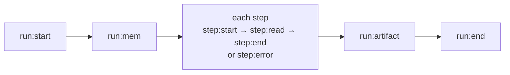

# Run log and manifest

Two JSON views of a project: the **run log** says what a run did; the **manifest** says what the project defines,
without running anything.

## The run log

Every `run`, `demo` and `test` writes `.waygraph/runs/<runId>.jsonl`, one event per line, and prints
`waygraph: run log <file>` when it ends. `runLog: false` in the config turns it off; `runLog: "<folder>"` moves it.



| Event | Carries |
|---|---|
| `run:start` | the run's id and what it plays (`label`: the flow or chain; under `waygraph test --flows`, the flow's export name; none for a test that calls `flow.run` itself) |
| `run:mem` | the mem each part of the run was seeded with, by key name (what `--replay <runId>` seeds again, a per-run value made new), and the flow's `meta` (title, description, labels, ticket, owner) when it has one |
| `step:start` | the Block, its kind (`nav`, `page`, `method`, `effect`, `api`), where it starts; `parent` for a step inside a fast-forward unit, `cleanup: true` for a `.finally` step, `pane` for a step in a flow with panes ([Split view](../guides/split-view)) |
| `interrupt` | a layout's interrupt showed up and was handled: `{ layout, name, index? }` ([Layouts](../guides/layouts#interrupts-what-appears-and-gets-in-the-way)) |
| `step:read` | what the page showed after the step: `{ checkpoint, read, missing, notes, readBlocks }` ([What a page shows](../guides/reads)) |
| `step:end` | where it landed, how long it took, the page's address (`url`) |
| `step:error` | the failure; for a failed check, `check: { trait, block, wants, saw, url, heading }` |
| `run:artifact` | a saved video or screenshot; a Block's screenshot (`screenshot: true`) also names its step (`index`, `block`) and the page (`checkpoint`) |
| `compare:diff` | a compared run (`--compare`): after its `step`-th step (`block`), where the two `sides` differed (`diffs`: what landed, the outcome, a read field `key`, with both `values`) and the two steps in the log (`indexes`) |
| `run:end` | ok, the result or the error |

Each run has its own id, even when several run at once in one process (parallel `traverse` workers). In code:

```ts
import { onRunEvent } from "waygraph";

onRunEvent((event) => {
  if (event.type === "step:error") console.log(event.check?.saw);
});
```

`WAYGRAPH_JSON=1 waygraph run <flow>` prints one JSON report instead, with the same `runId`.

## The manifest

```sh
npx waygraph manifest [project] [--out manifest.json]
```

| Lists | With |
|---|---|
| every Block | `kind`, `description`, route `from` → `to`, `requires`, `file` and `source` (the lines that define it), its `map` group; a Nav or Page Block's `url` (a url built from mem as a pattern: `/requests/:id`); `checks`: its precondition and verify Traits as data (`name`, `wants`, `selector`; `"dynamic"` when a function builds them); `selectors`: the selector entries its definition reads (`LoginSel.submit` with its string, file and line); `for`: the accounts it's given, when it says |
| every selector entry | `selectors`: each entry of the project's selector files (`_sel.ts`, `*.sel.ts`): its name, its selector (or the code that builds one), file and line. Read from the source, so `LoginSel.x` reached through another variable isn't linked to its Block |
| every page's addresses | `pageUrls`: by Checkpoint, its Navs' urls and the `Trait.url` its Blocks verify |
| the site map | `siteTree`: its `sites`, the `folders` of their paths no page has, each page's path (`paths`) and each page's and folder's parent (`parents`) |
| every layout | `layouts`: its name, `file`, the pages it `covers`, its `links` (the Block, where it leads or `"parent"`, its selector, its `for`), its `actions` and its Read Block ([Layouts](../guides/layouts)) |
| every account | `accounts`: the names of the project's accounts (`src/accounts/`) |
| a flow's panes | `panes` (each pane's name, `as`, `device`, `with`) and `stepPanes` (the pane each step plays in) ([Split view](../guides/split-view)) |
| the project | its name, folder, waygraph version, and `baseUrl` when one is set |
| its config | `config`: the `waygraph.config.*` file and what it resolves to (after `.env`), as JSON: a function shows as `(function name)` |
| every flow | its `useCase` (from `src/flows/<page>/<outcome>.flow.ts`), its steps in order, its settings, its `source` lines |
| every Checkpoint | its tag |
| every page's `read` (and layout's) | the Checkpoints it reads and the shape of its fields: `"catalog.items": [{ "name": "string", "price": "number" }]`; its `source` lines |

It's read from the Blocks themselves (the same scan `graph`, `check`, `auto` and the runner use), so it can't go
stale. Blocks from installed [map packages](./map#map-packages) are included, with the package name as their `map`.
In code: `buildManifest(projectDir)`. [Waygraph Studio](../guides/studio) (`waygraph studio`) draws it, with the runs.
