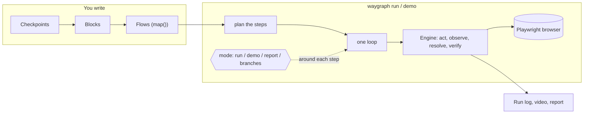

---
tags:
  - waygraph
  - concept
aliases:
  - The model
  - Video editor model
---

# How Waygraph works

## Your model, and what to adjust

You described it as: *an engine, like a video editor, takes Blocks onto a timeline; the engine then plays the timeline
with Playwright; it has different strategies (run, demo, ...) depending on the params.* That is right. Four
adjustments make it exact:

> [!success] Right
> - **Blocks are clips, a Flow is the timeline.** `engine.map()` is the editor: you drop Blocks onto it in order.
> - **One engine plays it, with Playwright.** Every mode drives the same engine, step by step.
> - **The params pick a strategy.** `run`, `demo`, the JSON report and `--all-branches` are different ways of playing.

> [!warning] Adjust 1 - the cuts must line up
> A clip has a **start frame and an end frame**: the [[Checkpoints]] it goes *from* and *to*. On the timeline, each
> clip must start on the frame the previous one ended on. `map()` refuses a jump cut ("no teleporting"): you can't put
> "add to cart" right after "open login page", because the cart button isn't on the login page.

> [!warning] Adjust 2 - the strategy isn't inside the engine
> The engine always plays a Block the same way ([[The Engine]]). The strategy lives one level up, in the **runner**:
> one loop walks the timeline and hands each step to the engine, and a **mode** decides what happens *around* each
> step. `run` does nothing extra; `demo` shows a panel, waits for Next, paints rings. See [[Playing a Flow]].

> [!warning] Adjust 3 - a timeline can branch and nest
> `.branch()` splits the timeline by where a step landed (logged in, or still on the login page), and `.flow(sub)`
> drops a whole other timeline in, like a nested sequence.

> [!warning] Adjust 4 - not everything plays a timeline
> `waygraph auto`, `pilot` and `traverse` don't play a saved Flow: they open a browser and offer **every Block that can
> start from the current Checkpoint**, like a choose-your-path menu. See [[Live Sessions]].

## The picture

## Two sides of the code

- **Authoring side** - building Blocks and Flows. Starts at `src/engine/engine.ts`.
- **Running side** - `waygraph run` / `demo`. Starts at `src/cli/cli.ts`, then `src/runner/runner.ts`.

Details: [[Inside the Code]].
