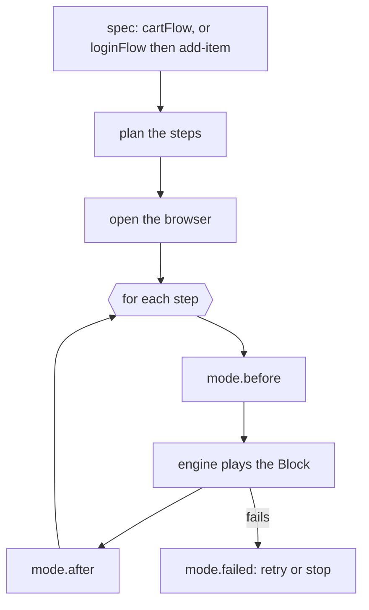

---
tags:
  - waygraph
  - concept
aliases:
  - Modes
  - run vs demo
  - Runner
---

# Playing a flow - run, demo and the other modes

`waygraph run cartFlow` and `waygraph demo cartFlow` do the same thing: play the flow's steps through [[The Engine]].
The difference is what happens **around** each step. That "around" is a **mode**.

| Mode | How you get it | Around each step |
|---|---|---|
| **run** | `waygraph run` | nothing - plays like a Playwright test |
| **demo** | `waygraph demo` | a panel before (what's next, its [[Mem]], a Next button), rings after, `ctx.ui.slides` before or after (from the flow's stubs), Retry/Stop on failure. See [[Demo UI]] |
| **report** | `waygraph run` with `WAYGRAPH_JSON=1` | records each step's Checkpoint and time, prints one JSON report |
| **branches** | `waygraph run <flow> --all-branches` | instead of one path, plays every route of a `.branch()` tree |

The params tune a mode, not the engine: `--fast` and `--auto-next` (demo gates), `--video` (record),
`--non-headless`, `--mem-stub`, `--data`, `pace` on a step.

The same loop handles what every mode shares: seeding each segment's mem when it starts, a fresh session between
episodes, an **expected failure** (a flow meant to fail stops cleanly), and "Retry episode".

> [!example] Adding a mode
> A new way to play steps is one file in `src/runner/modes/` that returns the hooks it wants.

`waygraph test` is different: it runs your Playwright test files with the project's config, and those tests call
`flow.run(...)` themselves.

Code: `src/runner/runner.ts` (the whole story in ~60 lines), `play-steps.ts` (the loop), `modes/`.
