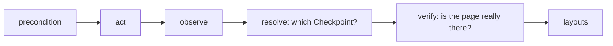

---
tags:
  - waygraph
  - concept
aliases:
  - Engine
  - runGraph
---

# The engine

The engine plays [[Blocks]] with Playwright. For **each Block**, always the same sequence:

1. **precondition** - is the page ready for this step?
2. **act** - Playwright does the work (fill, click, request).
3. **observe** - read the outcome, if the Block can land in more than one place.
4. **resolve** - name the [[Checkpoints|Checkpoint]] reached.
5. **verify** - Traits prove the page matches (right URL, right text visible). A failing Trait stops the run with
   the Block's name and the check that failed.
6. **layouts** - checks that apply to many Checkpoints at once (a sidebar that must always be there).

Then it moves to the next Block, handing it the Checkpoint just reached. Each step emits **run events**
(`step:start`, `step:end`, `step:error`), which become the run log ([[What Waygraph Writes]]).

> [!info] The engine doesn't know about modes
> It plays Blocks; it has no idea whether this is a plain run or a demo. Modes live in the runner:
> [[Playing a Flow]].

`new Engine(config)` holds what every flow built from it shares: how to launch a browser (when a flow opens its own)
and the layouts. A project builds one in `config/waygraph.config.ts` and flows import it.

Code: `src/engine/` - start at `engine.ts`; the per-Block sequence is `run/run.ts`.
